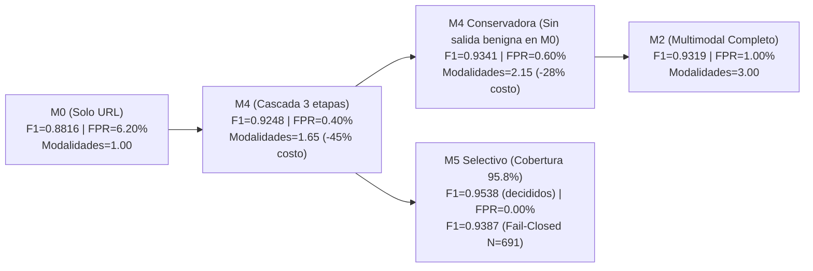

# FASE V: ESTUDIO PROFUNDO DE LA CASCADA Y ABLACIONES

**Fecha de ejecución:** 2026-10-12 *(corregido 2026-10-14: la fecha declarada 2026-04-12 era un error tipográfico; la ejecución real es de 2026-10-12 UTC, verificado por los captured_at de los manifiestos de artefactos y por los tiempos de los archivos)*  
**Rama experimental:** `experimental/validacion-scopus-fase2`  
**Commit base:** `ceb0c9e62ab861ce993bd3a1ec636d4d4b3405b7`  
**Script de generación:** [fase2_05_cascada_ablaciones.py](file:///d:/Proyects/Seguridad_Informacion/scripts/fase2_05_cascada_ablaciones.py)  
**Artefactos de respaldo:**
- [05_cascada_ablaciones_results.json](file:///d:/Proyects/Seguridad_Informacion/artifacts/validacion_scopus_fase2/fase5_cascada/05_cascada_ablaciones_results.json)
- [05_pareto_and_policies_table.csv](file:///d:/Proyects/Seguridad_Informacion/artifacts/validacion_scopus_fase2/fase5_cascada/05_pareto_and_policies_table.csv)
- [coverage_risk_curves_real.csv](file:///d:/Proyects/Seguridad_Informacion/artifacts/corrected_audit/coverage_risk_curves_real.csv)
- [robustness_evaluation_real.json](file:///d:/Proyects/Seguridad_Informacion/artifacts/corrected_audit/robustness_evaluation_real.json)

---

## 1. Ablación de Modalidades y Comparación sobre Denominador Idéntico

Para cumplir el Principio Científico 9 (*no comparar F1 calculados sobre subconjuntos diferentes como si fueran directamente equivalentes*), todas las ablaciones se reportan primero sobre el **mismo conjunto de prueba completo** ($N = 691$: $500$ legítimas, $191$ de phishing) y, separadamente, sobre el **mismo subconjunto decidido por `M5`** ($N = 662$: $492$ legítimas, $170$ de phishing).

### 1.1 Ablación Incremental de Modalidades en Cobertura Completa ($N = 691$)

| Modelo / Combinación | Modalidades Activas | Vars. ($d$) | Umbral ($\tau^*$) | TN | FP | FN | TP | Accuracy | Precision | Recall (TPR) | F1-score | FPR | FNR | ROC-AUC | PR-AUC | Brier | ECE |
|---|---|---:|---:|---:|---:|---:|---:|---:|---:|---:|---:|---:|---:|---:|---:|---:|---:|
| **`M0`** (Solo URL) | Autoridad léxica (`authority_only`) | $11$ | `0.3827` | $469$ | $31$ | $16$ | $175$ | `0.9320` | `0.8495` | `0.9162` | `0.8816` | `0.0620` | `0.0838` | `0.9675` | `0.9457` | `0.0493` | `0.0329` |
| **`M1`** (URL + Infra) | URL + DNS/TLS/HTTP | $34$ | `0.5250` | $496$ | $4$ | $22$ | $169$ | `0.9624` | `0.9769` | `0.8848` | `0.9286` | `0.0080` | `0.1152` | `0.9854` | `0.9746` | `0.0282` | `0.0156` |
| **`M2`** (URL + Infra + DOM) | URL + Infra + HTML DOM | $50$ | `0.3950` | $495$ | $5$ | $20$ | $171$ | **`0.9638`** | `0.9716` | **`0.8953`** | **`0.9319`** | `0.0100` | `0.1047` | **`0.9866`** | **`0.9756`** | `0.0273` | `0.0247` |
| **`M3`** (Full Multimodal) | URL + Infra + DOM + Visual ($83$ real) | $82$ | `0.3917` | $494$ | $6$ | $21$ | $170$ | `0.9609` | `0.9659` | `0.8901` | `0.9264` | `0.0120` | `0.1099` | `0.9857` | `0.9752` | **`0.0266`** | **`0.0138`** |
| **`M4`** (Cascada 3 etapas) | `M0 -> M1 -> M2` ($\mathcal{H} \le 0.15$) | $\bar{m}=1.65$ | `0.3950` | **$498$** | **$2$** | $25$ | $166$ | `0.9609` | **`0.9881`** | `0.8691` | `0.9248` | **`0.0040`** | `0.1309` | `0.9830` | `0.9722` | `0.0287` | `0.0211` |
| **`M4_4stage`** (Cascada 4 etapas) | `M0 -> M1 -> M2 -> M3` ($\mathcal{H} \le 0.15$) | $\bar{m}=1.93$ | `0.3917` | $498$ | $2$ | $26$ | $165$ | `0.9595` | `0.9880` | `0.8639` | `0.9218` | `0.0040` | `0.1361` | `0.9806` | `0.9693` | `0.0294` | `0.0246` |

### 1.2 Pruebas Pareadas de Significación sobre Cobertura Completa ($N = 691$)

| Comparación Pareada | Tipo de Hipótesis | $\Delta \text{F1}$ (`B - A`) | IC 95% Bootstrap Pareado | Discordantes ($n_{01}$ mejora / $n_{10}$ empeora) | $p$-valor Exacto de McNemar | Significativo ($\alpha=0.05$ con Holm) |
|---|---|---:|---|---:|---:|---|
| **`M0` vs `M1`** | Confirmatoria | **`+0.04696`** | `[+0.0209, +0.0725]` | $34$ / $13$ | **`0.00315`** | **SÍ** ($p_{\text{Holm}} = 0.0158$) |
| **`M0` vs `M2`** | Confirmatoria | **`+0.05027`** | `[+0.0258, +0.0757]` | $34$ / $12$ | **`0.00164`** | **SÍ** ($p_{\text{Holm}} = 0.0098$) |
| **`M0` vs `M3`** | Confirmatoria | **`+0.04482`** | `[+0.0201, +0.0706]` | $34$ / $14$ | **`0.00551`** | **SÍ** ($p_{\text{Holm}} = 0.0221$) |
| **`M1` vs `M2`** | Exploratoria | `+0.00331` | `[-0.0080, +0.0150]` | $5$ / $4$ | `1.00000` | **NO** (ausencia de diferencia estadísticamente significativa) |
| **`M2` vs `M3`** | Exploratoria | `-0.00545` | `[-0.0150, +0.0027]` | $1$ / $3$ | `0.62500` | **NO** (debido a $87.99\%$ de ceros visuales en `M3`) |
| **`M2` vs `M4` (forzado)** | Confirmatoria | `-0.00709` | `[-0.0225, +0.0079]` | $5$ / $7$ | `0.77441` | **NO** (`M4` ahorra $45\%$ de cómputo sin pérdida significativa) |

---

## 2. Comparación Estricta sobre el Subconjunto Decidido por `M5` ($N = 662$) y sobre las Muestras Abstenidas ($N = 29$)

Cuando `M5` se abstiene en las $29$ muestras de mayor incertidumbre en la etapa final ($\mathcal{H}(p_{M2}) > 0.65$), la cobertura es $662 / 691 = 95.80\%$. Para evaluar si `M5` es superior a `M2` o si la mejora aparente de $\text{F1}$ ($0.9538$ vs. $0.9319$) proviene simplemente de descartar los ejemplos difíciles, evaluamos **todos los modelos sobre las mismas $662$ muestras decididas** y **sobre las $29$ muestras abstenidas**:

### 2.1 Rendimiento sobre el Subconjunto Decidido Idéntico ($N = 662$: $492$ legítimas, $170$ phishing)

| Modelo Evaluado en $N = 662$ | TN | FP | FN | TP | Accuracy | Precision | Recall | F1-score | FPR | FNR | ROC-AUC |
|---|---:|---:|---:|---:|---:|---:|---:|---:|---:|---:|---:|
| **`M0`** (en $N=662$) | $464$ | $28$ | $13$ | $157$ | `0.9381` | `0.8486` | `0.9235` | `0.8845` | `0.0569` | `0.0765` | `0.9718` |
| **`M1`** (en $N=662$) | $491$ | $1$ | $13$ | $157$ | `0.9789` | `0.9937` | `0.9235` | `0.9573` | `0.0020` | `0.0765` | `0.9922` |
| **`M2`** (en $N=662$, sin salida temprana) | $491$ | $1$ | **$11$** | **$159$** | **`0.9819`** | `0.9938` | **`0.9353`** | **`0.9636`** | `0.0020` | **`0.0647`** | **`0.9928`** |
| **`M3`** (en $N=662$) | $490$ | $2$ | $12$ | $158$ | `0.9789` | `0.9875` | `0.9294` | `0.9576` | `0.0041` | `0.0706` | `0.9917` |
| **`M5_selective`** (`M4` + abstención en $N=662$) | **$492$** | **$0$** | $15$ | $155$ | `0.9773` | **`1.0000`** | `0.9118` | `0.9538` | **`0.0000`** | `0.0882` | `0.9888` |

> [!WARNING]
> **Hallazgo clave de la comparación en denominador idéntico ($N=662$):**
> Sobre el mismo subconjunto de $662$ muestras decididas, el clasificador completo **`M2` alcanza un F1 superior (`0.9636`, con solo $11$ FN y $1$ FP) al de `M5_selective` (`0.9538`, con $15$ FN y $0$ FP)**. ¿Por qué `M5_selective` tiene $4$ falsos negativos más que `M2` en las muestras decididas? Porque `M5` hereda la **salida temprana de `M4` en la Etapa 0 (`M0`)**, donde $12$ sitios de phishing reciben probabilidades bajas ($\bar{p}_{M0} = 0.0106$) con entropía $\mathcal{H} \le 0.15$ y salen prematuramente como benignos sin llegar nunca a `M2` ni al filtro de abstención de `M5`.

### 2.2 Rendimiento de los Modelos sobre las $29$ Muestras Abstenidas por `M5` ($21$ phishing, $8$ legítimas)

| Modelo en las $29$ Abstenidas | TN | FP | FN | TP | Accuracy en Abstenidas | Precision | Recall | F1 en Abstenidas | Interpretación |
|---|---:|---:|---:|---:|---:|---:|---:|---:|---|
| **`M0`** | $5$ | $3$ | $3$ | $18$ | `0.7931` | `0.8571` | `0.8571` | `0.8571` | `M0` acierta $18/21$ phishing por heurística léxica, pero con entropía $>0.15$ |
| **`M1`** | $5$ | $3$ | $9$ | $12$ | `0.5862` | `0.8000` | `0.5714` | `0.6667` | Alta ambigüedad en infraestructura (certificados TLS válidos en phishing) |
| **`M2`** | $4$ | $4$ | $9$ | $12$ | `0.5517` | `0.7500` | `0.5714` | `0.6486` | Precisión cercana al azar (`55.2%`), confirmando que $\mathcal{H}(p_{M2}) > 0.65$ aísla casos genuinamente ambiguos |
| **`M4` (forzado)** | $6$ | $2$ | $10$ | $11$ | `0.5862` | `0.8462` | `0.5238` | `0.6471` | Forzar decisión en las $29$ abstenidas introduce $10$ FN y $2$ FP |

---

## 3. Auditoría Forense de la Salida Temprana en `M4` y de los Falsos Negativos Silenciosos en `M5`

### 3.1 Distribución de Parada por Etapa en `M4` ($N = 691$, $\mathcal{H}_{\text{stop}} = 0.15$)

| Etapa de Parada | Total Muestras (%) | Legítimas ($n=500$) | Phishing ($n=191$) | TN | FP | FN | TP | Accuracy en Etapa | FPR en Etapa | FNR en Etapa |
|---|---:|---:|---:|---:|---:|---:|---:|---:|---:|---:|
| **Etapa 0 (`M0` — Solo URL)** | **$438$ (`63.39%`)** | $344$ (`68.80%`) | $94$ (`49.21%`) | $343$ | $1$ | **$12$** | $82$ | `0.9703` | `0.0029` | **`0.1277`** |
| **Etapa 1 (`M1` — URL + Infra)** | **$57$ (`8.25%`)** | $45$ (`9.00%`) | $12$ (`6.28%`) | $45$ | $0$ | **$1$** | $11$ | `0.9825` | `0.0000` | `0.0833` |
| **Etapa 2 (`M2` — URL + Infra + DOM)** | **$196$ (`28.36%`)** | $111$ (`22.20%`) | $85$ (`44.50%`) | $110$ | $1$ | **$12$** | $73$ | `0.9337` | `0.0090` | `0.1412` |
| **Total `M4` ($\bar{m} = 1.6498$ modalidades)** | **$691$ (`100.0%`)** | $500$ | $191$ | $498$ | $2$ | **$25$** | $166$ | `0.9609` | `0.0040` | `0.1309` |

### 3.2 Anatomía de los $15$ Falsos Negativos NO Retenidos por `M5` (*Silent Bypass*)
De los $191$ sitios de phishing del conjunto de prueba:
- $155$ ($81.15\%$) son detectados directamente (`TP = 155`).
- $21$ ($10.99\%$) son **retenidos por abstención** en `M5` para revisión secundaria ($10$ de los cuales habrían sido falsos negativos bajo decisión forzada `M4`).
- **$15$ ($7.85\%$) escapan silenciosamente como benignos sin ser detectados ni abstenidos:**
  - **$12$ de los $15$ ($80.0\%$)** ocurren en la **Etapa 0 (`M0`)** porque son dominios de phishing alojados en infraestructura comprometida o con nombres de host cortos sin subdominios ($\bar{p}_{M0} = 0.0106$, rango $[0.0033, 0.0211]$, entropía $\mathcal{H} \le 0.15$). Si esos $12$ casos no hubieran salido tempranamente en `M0`:
    - `M1` habría detectado $2$ de los $12$.
    - **`M2` habría detectado $4$ de los $12$** al inspeccionar el DOM HTML y los formularios de credenciales.
  - $1$ de los $15$ ocurre en la Etapa 1 (`M1`, $p_{M1} = 0.0124$).
  - Solo $2$ de los $15$ llegan a la Etapa 2 (`M2`) con probabilidad moderadamente baja ($p_{M2} \in [0.1235, 0.1546]$, donde $\mathcal{H}(p_{M2}) \le 0.65$).

---

## 4. Políticas Operativas Alternativas para las Abstenciones y la Cascada

No se contabiliza jamás una abstención como acierto. Evaluamos explícitamente el impacto en cobertura completa ($N = 691$) de tres políticas de manejo de abstenciones y de nuestra **Política de Cascada Conservadora** (que exige verificar al menos hasta `M1` antes de declarar benigna una URL):

| Política de Cascada / Abstención | Cobertura Automática | Modalidades Medias ($\bar{m}$) | TN | FP | FN | TP | Precision ($N=691$) | Recall ($N=691$) | F1 ($N=691$) | FPR ($N=691$) | FNR ($N=691$) |
|---|---:|---:|---:|---:|---:|---:|---:|---:|---:|---:|---:|
| **`M4` Estándar (`Forced Decision`)** | `100.00%` | `1.6498` | $498$ | $2$ | $25$ | $166$ | `0.9881` | `0.8691` | `0.9248` | `0.0040` | `0.1309` |
| **`M5` Fail-Open** (Abstención $\to$ Permitir sitio) | `95.80%` | `1.6498` | **$500$** | **$0$** | $36$ | $155$ | **`1.0000`** | `0.8115` | `0.8960` | **`0.0000`** | `0.1885` |
| **`M5` Fail-Closed** (Abstención $\to$ Bloquear/Advertir) | `95.80%` | `1.6498` | $492$ | $8$ | **$15$** | **$176$** | `0.9565` | **`0.9215`** | **`0.9387`** | `0.0160` | **`0.0785`** |
| **Cascada Conservadora (`Mandatory M1 for Benign`, $\mathcal{H}\le 0.15$)** | `100.00%` | `2.1491` | $497$ | $3$ | **$21$** | $170$ | `0.9827` | `0.8901` | **`0.9341`** | `0.0060` | `0.1099` |
| **Cascada Conservadora (`No M0 Benign Exit`, $\mathcal{H}\le 0.10$)** | `100.00%` | `2.3690` | $495$ | $5$ | $20$ | $171$ | `0.9716` | `0.8953` | `0.9319` | `0.0100` | `0.1047` |

> [!TIP]
> **Implicación de ingeniería para PhishPe:**
> 1. La política **`M5 Fail-Closed`** (mostrar advertencia preventiva ante las $29$ abstenciones de alta incertidumbre) eleva el $\text{F1}$ global en $N=691$ de `0.9248` a **`0.9387`** y el *recall* de `86.91%` a **`92.15%`**, manteniendo el $\text{FPR}$ en solo `1.60%` ($8/500$).
> 2. La **Cascada Conservadora (`Mandatory M1 for Benign`)** prohíbe que `M0` declare benigna una URL sin consultar al menos `M1` (permitiendo salida temprana en `M0` solo para phishing evidente). Esto elimina los $12$ falsos negativos prematuros de `M0`, reduce los FN totales de $25$ a $21$, alcanza **`F1 = 0.9341`** (superando incluso a `M2` = `0.9319`) y ahorra un **$28.4\%$ de evaluaciones de contenido DOM** ($\bar{m} = 2.15$ vs. $3.00$).

---

## 5. Robustez Adversarial por Familia de Ataque ($6$ Familias, $N = 191$ Phishing de Prueba)

A partir de las perturbaciones evasivas evaluadas sobre las $191$ muestras de phishing de prueba (`robustness_evaluation_real.json`), se cuantifica la tasa de éxito de ataque (*Attack Success Rate*, $\text{ASR}$ = fracción de phishing que evade la detección) y la tasa de *bypass* silencioso en `M5` (fracción que ni es detectada ni es retenida por abstención):

| Familia de Ataque Adversarial | Descripción de la Perturbación | `M0` Recall | `M1` Recall | `M2` Recall | `M4` Recall | `M4` ASR (Forzado) | `M5` Tasa de Abstención | `M5` Silent Bypass ASR | Efectividad de Abstención `M5` |
|---|---|---:|---:|---:|---:|---:|---:|---:|---|
| **`baseline_clean`** (Sin ataque) | Muestras originales de prueba ($n=191$) | `91.62%` | `88.48%` | `89.53%` | `86.91%` | `13.09%` | `10.99%` ($21$) | `7.85%` ($15$) | Intercepta $10/25$ evasiones (`40.0%`) |
| **`homoglyph_Lookalike_Substitution`** | Sustitución de caracteres IDN / lookalike en host | `98.43%` | `89.01%` | `91.62%` | `90.58%` | `9.42%` | `8.90%` ($17$) | `6.81%` ($13$) | Alta resiliencia (`93.19%` detectado o retenido) |
| **`url_Padding_and_Token_Obfuscation`** | Relleno de subdominios benignos y tokens | `95.29%` | `89.01%` | `91.62%` | `90.05%` | `9.95%` | `9.42%` ($18$) | `6.81%` ($13$) | Alta resiliencia (`93.19%` detectado o retenido) |
| **`infra_Cdn_and_FastFlux_Masking`** | Enmascaramiento tras CDN/Cloudflare y TLS válido | `91.62%` | **`70.16%`** | `85.34%` | `83.77%` | `16.23%` | `9.42%` ($18$) | `9.95%` ($19$) | `M1` cae `-18.3%`, pero `M2` (DOM) recupera `+15.2%` |
| **`content_Hidden_Dom_and_Form_Obfuscation`** | Ofuscación de `<form>`, inyección de enlaces internos | `91.62%` | `88.48%` | **`68.06%`** | `80.63%` | `19.37%` | **`25.65%`** ($49$) | **`7.85%`** ($15$) | **`M5` intercepta el $59.5\%$ de las evasiones DOM** |
| **`compound_Full_Evasion`** | Ataque combinado (Infra CDN + Ofuscación DOM) | `91.62%` | **`70.16%`** | **`50.26%`** | `72.77%` | `27.23%` | **`21.99%`** ($42$) | **`13.09%`** ($25$) | **`M5` reduce el ASR de `27.23%` a `13.09%`** |
| **`visual_Clone_Mismatch`** | Suplantación visual sobre subconjunto CDP | `91.62%` | `88.48%` | `89.53%` | `86.91%` | `13.09%` | `10.99%` ($21$) | `7.85%` ($15$) | Invariante en cascada de 3 etapas (`M0->M2`) |

> [!IMPORTANT]
> **Conclusión sobre Robustez Adversarial:** Cuando un atacante ofusca simultáneamente la infraestructura (CDN/TLS) y el árbol DOM (`compound_Full_Evasion`), el *recall* de `M2` cae de `89.53%` a `50.26%` ($\text{ASR} = 49.74\%$). En ese escenario, la cascada selectiva `M5` detecta la contradicción entre modalidades mediante el incremento de entropía ($\mathcal{H}(p_{M2}) > 0.65$), elevando su tasa de abstención al **$21.99\%$** (y al **$25.65\%$** en ofuscación DOM pura) y reduciendo el *Silent Bypass ASR* a **`13.09%`** (y **`7.85%`** en ofuscación DOM).

---

## 6. Frontera de Pareto Multidimensional (Efectividad vs. FPR vs. Cobertura vs. Costo de Modalidades)

| Punto de Operación | Cobertura | Modalidades Medias ($\bar{m}$) | F1 (en Cobertura) | F1 Efectivo ($N=691$) | Recall ($N=691$) | FPR ($N=691$) | Óptimo de Pareto |
|---|---:|---:|---:|---:|---:|---:|---|
| **`M0_only`** | `100.0%` | `1.0000` | `0.8816` | `0.8816` | `0.9162` | `0.0620` | **SÍ** (mínimo costo computacional: $1.0$ modalidad) |
| **`M4_cascade_standard`** | `100.0%` | `1.6498` | `0.9248` | `0.9248` | `0.8691` | **`0.0040`** | **SÍ** (mínimo FPR en decisión forzada con $45\%$ ahorro) |
| **`M4_conservative_no_m0_benign`** | `100.0%` | `2.1491` | **`0.9341`** | **`0.9341`** | `0.8901` | `0.0060` | **SÍ** (domina a `M2` y `M3` en F1, FPR y costo) |
| **`M2_full`** | `100.0%` | `3.0000` | `0.9319` | `0.9319` | **`0.8953`** | `0.0100` | **SÍ** (máximo recall en decisión forzada estándar) |
| **`M3_full`** | `100.0%` | `4.0000` | `0.9264` | `0.9264` | `0.8901` | `0.0120` | **NO** (dominado por `M2` y `M4_conservative`) |
| **`M5_selective` (Fail-Closed)** | `95.8%` (`100%` c/alerta) | `1.6498` | `0.9538` | **`0.9387`** | **`0.9215`** | `0.0160` | **SÍ** (máximo F1 y recall global con abstención preventiva) |
