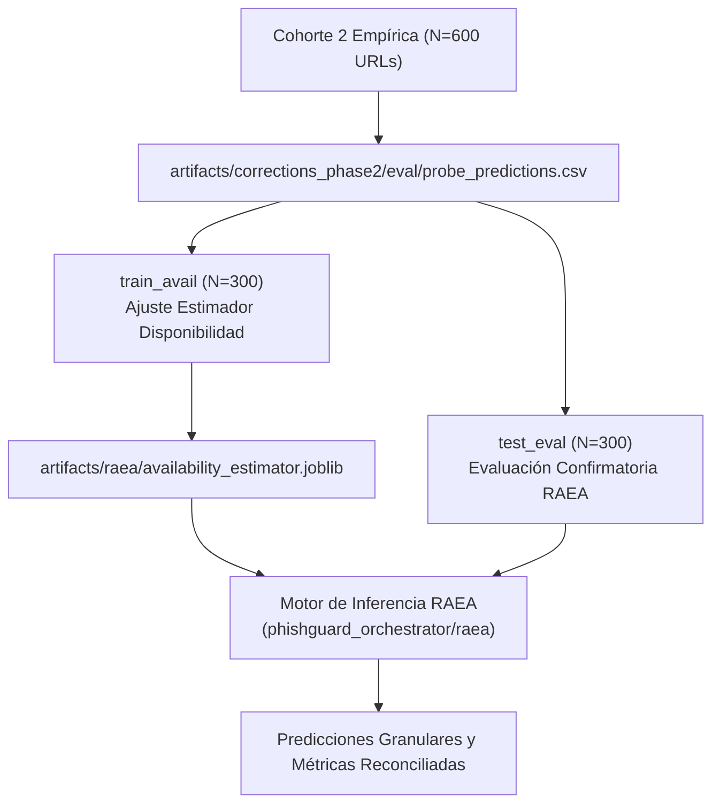

# DEPENDENCIAS EXPERIMENTALES, PARTICIONES Y TRAZABILIDAD
**Proyecto:** PhishPe / RAEA-Phish  
**Rama de Trabajo:** `research/risk-aware-policy`  
**Referencia Histórica:** `corrections-phase2` (`058169a99786a42203d7db27d5da994b6ceb61c9`)

---

## 1. FUENTES DE DATOS PRIMARIAS

La experimentación de RAEA-Phish se sustenta exclusivamente en datos observados y modelos preexistentes, sin síntesis artificial de registros.

### 1.1. Detalle de la Cohorte 2
- **Tamaño total:** $N = 600$ URLs adquiridas y sondeadas empíricamente.
- **Distribución de clases:** 300 instancias de phishing y 300 instancias legítimas.
- **Evidencia multimodal registrada en `probe_predictions.csv`:**
  - `p_m0`: Probabilidad predicha por el clasificador léxico $M_0$ (URL cruda).
  - `p_m1`: Probabilidad predicha por el clasificador de red $M_1$ (URL + DNS + TLS).
  - `p_m2`: Probabilidad predicha por el clasificador de contenido $M_2$ (URL + Red + HTML/DOM).
  - `infra_status`: Resultado del intento de resolución DNS y handshake TLS (`success`, `blocked`, `error`).
  - `content_status`: Resultado de la petición HTTP y extracción DOM (`success`, `error`).
  - `lat_m0_ms`, `lat_infra_ms`, `lat_content_ms`: Latencias empíricas en milisegundos observadas durante la captura real.

---

## 2. ESQUEMA DE PARTICIÓN Y PREVENCIÓN DE DATA LEAKAGE

Para garantizar la estricta validez científica y evitar cualquier contaminación (*data leakage*):

1. **Partición de Entrenamiento del Estimador de Disponibilidad (`train_avail`):**
   - **Tamaño:** $N = 300$ (150 phishing, 150 legítimos).
   - **Uso exclusivo:** Entrenamiento del clasificador `RandomForestClassifier` para predecir la disponibilidad modal a partir de señales léxicas de la URL ($X_0$).
   - **Artefacto generado:** `artifacts/raea/availability_estimator.joblib`.

2. **Partición Confirmatoria de Evaluación (`test_eval`):**
   - **Tamaño:** $N = 300$ (150 phishing, 150 legítimos).
   - **Aislamiento:** Esta partición fue **estrictamente reservada** para la evaluación ciega final de las políticas (B0 a B6) y las variantes de ablación (A0 a A7).
   - **Ningún hiperparámetro ni estimador** fue ajustado sobre `test_eval`.

---

## 3. PARÁMETROS OPERACIONALES Y DE COSTE PRE-REGISTRADOS

Los parámetros que gobiernan el cálculo de utilidad de RAEA se establecieron conforme a los principios de coste asimétrico y restricciones de despliegue:

| Parámetro | Símbolo | Valor | Justificación Operacional |
|---|---|:---:|---|
| Ratio de Coste FN/FP | $\gamma = C_{\text{FN}} / C_{\text{FP}}$ | $15.0$ | Refleja la severidad crítica de una brecha por phishing frente a una molestia de falso positivo. |
| Coste Unitario de Falso Positivo | $C_{\text{FP}}$ | $1.0$ | Unidad base de penalización. |
| Coste de Abstención / Diferimiento | $C_{\text{abst}}$ | $0.35$ | Penalización por delegar a revisión manual o control de acceso secundario ($C_{\text{abst}} < C_{\text{FP}} \ll C_{\text{FN}}$). |
| Factor de Trade-off Coste/Riesgo | $\lambda$ | $0.25$ | Ponderación del consumo de recursos frente al riesgo de clasificación. |
| Guarda de Seguridad Benigna | $p_{\text{safe}}$ | $0.02$ | Umbral máximo de probabilidad inicial para permitir salida benigna anticipada en $M_0$. |
| Umbral Mínimo de Disponibilidad | $\tau_{\text{avail}}$ | $0.10$ | Impide adquirir modalidades con probabilidad de éxito inferior al 10%. |
| Presupuesto Normalizado Total | $B_0$ | $3.00$ | Límite superior de coste computacional por transacción. |

---

## 4. INTEGRIDAD DE LOS MODELOS HISTÓRICOS CONGELADOS

En estricto cumplimiento de los principios de auditoría:
- Los clasificadores $M_0, M_1, M_2$ y $M_3$ generados en `corrections-phase2` **no han sido modificados ni reentrenados**.
- Los pesos de los modelos base y sus calibradores permanecen congelados y verificados mediante sus firmas de integridad históricas.
