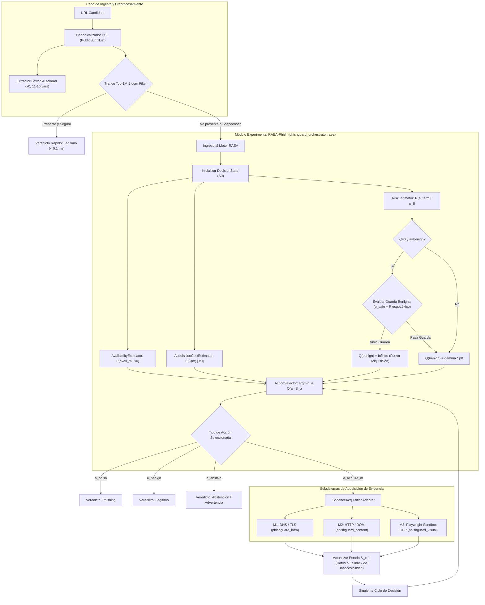
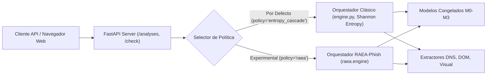

# DIAGRAMA_ARQUITECTURA.md: Arquitectura e Integración de RAEA-Phish

**Método:** RAEA-Phish  
**Subsistema:** Orquestador de Inferencia Adaptativa en PhishPe  

---

## 1. Diagrama de Arquitectura Modular de RAEA-Phish

---

## 2. Puntos de Acoplamiento y Convivencia Arquitectónica

---

## 3. Garantías de No Regresión y Aislamiento

1. **Aislamiento Funcional:** La lógica de RAEA-Phish reside en su propio espacio de nombres (`phishguard_orchestrator.raea`), sin modificar clases base de `engine.py`.
2. **Activación Segura:** Si la variable de entorno `PHISHGUARD_ORCHESTRATOR_POLICY` no está definida, el sistema ejecuta de manera 100% idéntica la cascada de entropía histórica.
3. **Auditabilidad Completa:** Cada ciclo de inferencia de RAEA produce una traza estructurada con los valores $\mathcal{Q}(a)$, la disponibilidad estimada $\pi_m$, el riesgo de Bayes y el estado de adquisición.
