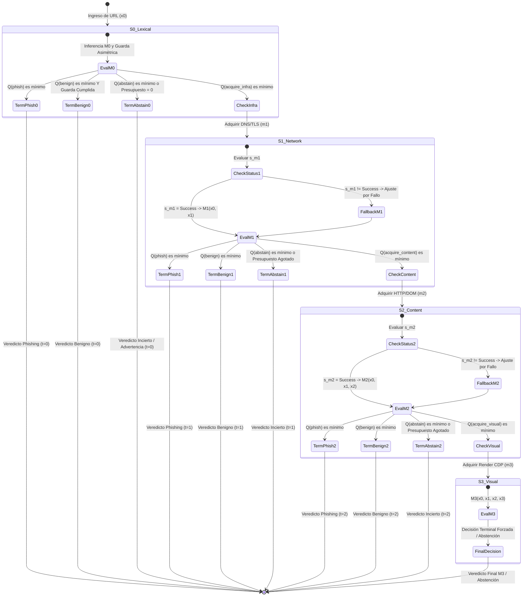

# MODELO_DE_DECISION.md: Modelo de Decisión Secuencial de RAEA-Phish

**Método:** RAEA-Phish  
**Paradigma:** Proceso de Decisión de Markov Parcialmente Observable (POMDP) estructurado en Cascada Adaptativa

---

## 1. Diagrama de Transición de Estados

---

## 2. Definición Detallada de Estados

- **$S_0$ (Estado Inicial Léxico):**
  - Entrada: URL pura canonicalizada y enriquecida con sufijos PSL.
  - Vector: $x_0 \in \mathbb{R}^{11}$ (características de autoridad: entropía del host, conteo de etiquetas, tokens sospechosos, longitud de dominio).
  - Probabilidad: $p_0 = M_0(x_0)$.
  - Latencia típica: $< 0.1\text{ ms}$.

- **$S_1$ (Estado de Infraestructura de Red):**
  - Entrada: Respuesta de resolución DNS y handshake TLS.
  - Vector: $x_1 \in \mathbb{R}^{25}$ (IPs asociadas, ASN, TTL mínimo, validez y emisor del certificado SSL, discrepancia entre host y Common Name).
  - Probabilidad: $p_1 = M_1([x_0, x_1])$ si la adquisición fue exitosa. Si falló, $p_1$ aplica factor correctivo por inaccesibilidad de red.
  - Latencia típica: $50\text{ ms} - 800\text{ ms}$.

- **$S_2$ (Estado de Contenido y Estructura DOM):**
  - Entrada: Código fuente HTML descargado y parseado.
  - Vector: $x_2 \in \mathbb{R}^{26}$ (proporción de enlaces externos/nulos, presencia de formularios de login, campos de contraseña, scripts externos, iframes ocultos).
  - Probabilidad: $p_2 = M_2([x_0, x_1, x_2])$.
  - Latencia típica: $200\text{ ms} - 1,500\text{ ms}$.

- **$S_3$ (Estado Visual y Perceptual):**
  - Entrada: Renderizado en sandbox Chromium mediante protocolo CDP.
  - Vector: $x_3 \in \mathbb{R}^{20}$ (hashing visual, similitud con marcas conocidas, presencia de logo institucional en host no autorizado).
  - Probabilidad: $p_3 = M_3([x_0, x_1, x_2, x_3])$.
  - Latencia típica: $1,000\text{ ms} - 3,000\text{ ms}$.

---

## 3. Condiciones de Parada y Criterio de Abstención

El sistema se detiene en la etapa $t$ si se satisface cualquiera de las siguientes condiciones:
1. **Dominancia de Acción Terminal:**
   $$\min \{ \mathcal{Q}(a_{\text{phish}} \mid S_t), \mathcal{Q}(a_{\text{benign}} \mid S_t) \} < \min_{m \in \mathcal{M} \setminus \mathcal{M}_t} \mathcal{Q}(a_m \mid S_t)$$
   sujeto al cumplimiento de la Guarda Benigna si $a = a_{\text{benign}}$ y $t=0$.
2. **Agotamiento del Presupuesto:**
   $$B_t < \min_{m \in \mathcal{M} \setminus \mathcal{M}_t} \text{Coste}(m)$$
   En este caso, si el riesgo terminal supera el umbral de abstención tolerable, el sistema emite $\hat{y} = \bot$ (*abstención*).
3. **Imposibilidad de Adquisición:**
   Si todas las modalidades pendientes tienen disponibilidad estimada $\pi_m(x_0) < \tau_{\text{avail\_min}}$ (p. ej., $\le 0.05$) o han fallado por timeout, el sistema detiene la cascada y decide con la evidencia acumulada o se abstiene.

---

## 4. Mecanismo de Fallback ante Fallos de Adquisición

Cuando una modalidad $m$ resulta inaccesible (`blocked`, `timeout`, `error`):
1. **No se asume malicia automática:** La regla 11 de rigor prohíbe clasificar como phishing únicamente porque el host no responde.
2. **Actualización Bayesiana con Evidencia de Fallo:**
   - Para sitios legítimos de alto tráfico, la inaccesibilidad es infrecuente ($\approx 13\%$).
   - Para sitios de phishing recientes, la inaccesibilidad es muy común ($\approx 48\% - 85\%$).
   - Se ajusta la probabilidad previa mediante un factor de verosimilitud de fallo calibrado:
     $$p_t^{\text{fail}} = \sigma \left( \text{logit}(p_{t-1}) + w_{\text{fail}} \cdot \mathbb{I}(\mathbf{s}_m \in \{\text{blocked}, \text{error}\}) \right)$$
   - Si la incertidumbre resultante impide una clasificación con riesgo aceptable, la política selecciona **Abstención** ($\hat{y} = \bot$), garantizando que el usuario reciba una advertencia preventiva de sitio no verificable.
