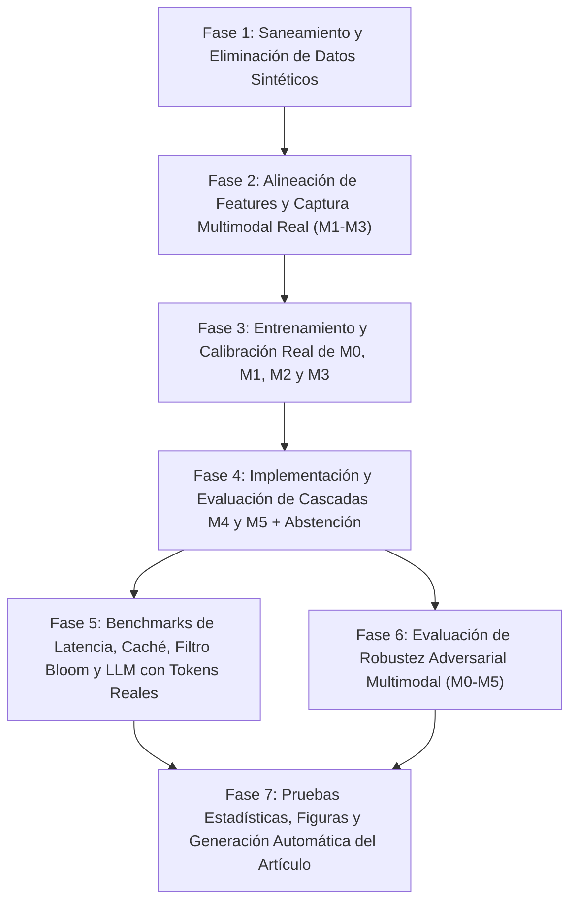

# Plan Maestro de Desarrollo, Implementación y Ejecución Experimental (100% Datos y Evidencia Real)

**Proyecto:** PhishGuard / PhishPe — Detección Multimodal Adaptativa de Phishing con Abstención Calibrada  
**Fecha:** 2026-10-11  
**Objetivo:** Eliminar por completo cualquier dato sintético, cifra escrita de forma estática (*hardcoded*), característica desconectada o experimento faltante, garantizando que **todas** las configuraciones ($M_0\text{--}M_5$), particiones (`conventional`, `host_unseen`, `temporal`), pruebas de latencia, caché, filtro Bloom, consumo de LLM y robustez adversarial se ejecuten con evidencia empírica real, reproducible y trazable hacia los archivos de `artifacts/` y el manuscrito del artículo.

---

## 1. Diagnóstico de Brechas Actuales que Este Plan Resuelve

| # | Brecha detectada en la auditoría | Estado actual en el repositorio | Solución definitiva en este plan |
| :--- | :--- | :--- | :--- |
| **G1** | **Datos sintéticos en `artifacts/`** | `scripts/generate_synthetic_results.py` generó 176,201 filas aleatorias condicionadas a `label` para entrenar `m1-baseline`, `m2-baseline` y `m3-baseline`. | Eliminación de scripts y artefactos sintéticos; prohibición mediante prueba automatizada de integridad. |
| **G2** | **Cobertura incompleta y sesgo de ceros en $M_1\text{--}M_3$** | En `m1-real` y `m2-real` solo 10,000 de 176,201 URLs fueron analizadas; 166,201 tienen ceros (`observation_available=0`). En `m3-real`, `visual-results-real.jsonl` tiene **0 bytes**, por lo que $M_3 = M_2$. | Definir dos cohortes transparentes según el protocolo: (1) **Corpus Completo URL ($N=176,201$)** para $M_0$, y (2) **Cohorte Multimodal Real Verificado** con extracción real completa de DNS/TLS/HTTP ($M_1$), DOM/HTML ($M_2$) y capturas reales Playwright + pHash/HSV ($M_3$) sin rellenar muestras no analizadas con ceros. |
| **G3** | **Features calculadas pero desconectadas del ML** | Fast-Flux y validez TLS en `phishguard_infra/analyzer.py`, exfiltración de formularios en `phishguard_content/analyzer.py` y `VisualBrandMatcher` en `phishguard_visual/matcher.py` no están incluidas en los vectores de entrenamiento de $M_1, M_2, M_3$. | Integrar todas las variables reales en `infrastructure.py`, `content.py` y `visual.py`, actualizando el registro de características (`feature-registry.json`). |
| **G4** | **Falta de evaluación de las cascadas $M_4$ y $M_5$** | No existen scripts de evaluación ni artefactos en `artifacts/` para $M_4$ (cascada adaptativa con decisión binaria forzada) ni $M_5$ (cascada adaptativa con abstención calibrada). | Implementar `scripts/evaluate_cascades.py` unificando la política de entropía de Shannon $H(p)$, calibrando umbrales en `validation` y evaluando en `test` (`host_unseen`, `conventional` y `temporal`). |
| **G5** | **Contradicción en reglas de escalamiento y abstención** | `engine.py` usa entropía $H(p) \le 0.20$; `worker.py` sobreescribe la abstención con umbrales $0.35 / 0.65$; `evaluation.py` usa distancia lineal $|p-0.5|\times 2$ y seleccionó el umbral sobre `test`. | Unificar la métrica de incertidumbre/confianza en todo el código y seleccionar todos los umbrales exclusivamente sobre la sub-partición `selection` de `validation`. |
| **G6** | **Sin mediciones reales de latencia, CPU/RAM ni hardware** | No hay artefactos que respalden los percentiles $P_{50}, P_{95}, P_{99}$, el ahorro de cómputo de $M_4/M_5$, ni el registro automático del hardware empleado. | Crear `scripts/benchmark_latency.py` que mida tiempos reales por etapa y extremo a extremo, consumo de memoria/CPU y registre las especificaciones exactas del hardware en `manifest.json`. |
| **G7** | **Caché y Filtro Bloom no evaluados (y Bloom desconectado)** | `PhishingBloomFilter` no está conectado a la API y no existen métricas empíricas de `ResultCache` ni del filtro Bloom. | Conectar `PhishingBloomFilter` al pipeline de inferencia y ejecutar `scripts/benchmark_cache_bloom.py` midiendo tasa de aciertos, tasa real de falsos positivos, memoria y latencia ($\mu\text{s}$). |
| **G8** | **Sin registro de tokens/costos reales en evaluación LLM** | `evaluate_llm.py` probó 100 URLs en vivo (46 fallaron por sitios caídos) y no conectó `BudgetTracker` ni guardó los tokens reales devueltos por la API de Groq. | Evaluar el LLM sobre el HTML real capturado en el cohorte multimodal (evitando caídas de red por URLs muertas) + subconjunto en vivo, registrando `prompt_tokens`, `completion_tokens`, costo real en USD y latencia. |
| **G9** | **Sin evaluación experimental de robustez adversarial** | `phishguard_robustness` solo tiene 3 perturbaciones básicas de URL y un test unitario con un modelo ficticio (`DummyModel`). | Ampliar `perturbations.py` a las 4 modalidades (incluyendo homógrafos IDN/Punycode, ofuscación DOM y perturbación visual) y evaluar la caída real de Recall/F1 y ASR en $M_0\text{--}M_5$. |
| **G10** | **Cifras inventadas/*hardcoded* en el generador del artículo** | `scratch/build_apa7_docx.py` tiene tablas con `1.0000`, $N=2,000$, LightGBM y GPU A100 escritos de forma estática. | Refactorizar `build_apa7_docx.py` para que lea dinámicamente todos los valores desde `artifacts/` y verificar con `scripts/verify_article_integrity.py` que el 100% de las cifras coincida con los JSON/CSV reales. |

---

## 2. Arquitectura de Fases de Desarrollo e Implementación

---

## Fase 1: Saneamiento, Auditoría de Datos y Eliminación de Artefactos Sintéticos

### 1.1. Limpieza de archivos sintéticos
1. Eliminar el script generador de datos sintéticos `scripts/generate_synthetic_results.py`.
2. Eliminar los archivos JSONL sintéticos:
   - `artifacts/analysis-results/infrastructure-results.jsonl`
   - `artifacts/analysis-results/content-results.jsonl`
   - `artifacts/analysis-results/visual-results.jsonl`
3. Eliminar los directorios de modelos entrenados con datos sintéticos:
   - `artifacts/m1-baseline/`
   - `artifacts/m2-baseline/`
   - `artifacts/m3-baseline/`
   - `artifacts/evaluation/evaluation_summary.json` y `artifacts/evaluation/evaluation_report.csv` (que provenían de los modelos sintéticos).

### 1.2. Auditoría y consolidación de particiones de datos (`data/processed/0.1.0/`)
1. Verificar y actualizar `data/processed/0.1.0/statistics.json` y `manifest.json` para que incluyan formalmente las tres particiones:
   - `conventional` ($123,341$ train / $26,430$ val / $26,430$ test).
   - `host_unseen` ($123,341$ train / $26,430$ val / $26,430$ test; $0$ dominios compartidos entre particiones).
   - `temporal` ($140,915$ train / $17,561$ val / $17,725$ test) y añadir una vista **`temporal_host_unseen`** (filtrando en `test` cualquier dominio registrado que haya aparecido en `train` o `validation`, tal como exige `docs/phase-0/experimental-protocol.md` línea 79).
2. Crear un recolector de metadatos de entorno y hardware (`src/phishguard_common/environment.py`) que capture automáticamente en cada corrida:
   - Modelo exacto de CPU, núcleos físicos/lógicos, RAM total/disponible, sistema operativo, versión de Python, paquetes clave y hash del commit de Git.

---

## Fase 2: Integración Completa de Características y Captura Multimodal Real ($M_1, M_2, M_3$)

### 2.1. Conexión de características reales en los módulos ML
Actualmente los analizadores calculan variables avanzadas que los extractores ML ignoran. Se actualizarán los esquemas de características para que **ninguna característica implementada quede desconectada**:

1. **Etapa $M_0$ — URL (`src/phishguard_ml/features.py`):**
   - Mantener el perfil primario `authority_only` (**11 características** libres de sesgo de estructura de ruta entre PhishTank y Tranco) y documentar explícitamente la ablación contra `full_url` (**36 características**).
2. **Etapa $M_1$ — Infraestructura (`src/phishguard_ml/infrastructure.py`):**
   - Incorporar a `INFRA_FEATURE_NAMES` las variables ya calculadas por `phishguard_infra/analyzer.py`:
     - `dns_distinct_slash24_count`
     - `dns_subnet_dispersion_ratio`
     - `fast_flux_probability`
     - `tls_cert_validity_days`
     - `tls_is_short_lived`
   - Total etapa infraestructura: **23 características** $\to$ **$M_1$ = 34 características acumuladas** (11 URL + 23 Infra).
3. **Etapa $M_2$ — Contenido HTML/DOM (`src/phishguard_ml/content.py`):**
   - Incorporar a `CONTENT_FEATURE_NAMES` las 5 variables de exfiltración de formularios calculadas por `phishguard_content/analyzer.py`:
     - `html_external_form_action_count`
     - `html_cross_origin_form_ratio`
     - `html_suspicious_form_endpoint_count`
     - `html_has_mailto_form`
     - `html_form_exfiltration_risk`
   - Total etapa contenido: **26 características** $\to$ **$M_2$ = 60 características acumuladas** (34 $M_1$ + 26 Contenido).
4. **Etapa $M_3$ — Visual (`src/phishguard_ml/visual.py` y `src/phishguard_visual/analyzer.py`):**
   - Conectar `VisualBrandMatcher` (`src/phishguard_visual/matcher.py`) al pipeline de extracción visual para calcular sobre cada captura real:
     - `visual_best_brand_similarity` (puntaje combinado pHash + histograma HSV contra plantillas de marcas reales)
     - `visual_phash_distance_min` (distancia de Hamming mínima de hash perceptual)
     - `visual_hsv_similarity_max` (correlación máxima de histograma de color HSV)
     - `visual_is_impersonation` (indicador binario de suplantación visual)
   - Total etapa visual: **13 características** (9 estadísticas de imagen + 4 de coincidencia de marca) $\to$ **$M_3$ = 73 características acumuladas** (60 $M_2$ + 13 Visual).

### 2.2. Captura real de la modalidad visual y estructuración del Cohorte Multimodal Real
Para evitar el error metodológico de entrenar/evaluar $M_1\text{--}M_3$ sobre 166,201 muestras vacías rellenadas con ceros:
1. **Estructuración del Cohorte Multimodal Real (`data/processed/0.1.0/multimodal_cohort/`):**
   - A partir de las 10,000 URLs ya analizadas en `infrastructure-results-real.jsonl` y `content-results-real.jsonl`, conservar todas las muestras con respuesta válida y preservar estrictamente su asignación original de partición (`train`, `validation`, `test`) en `host_unseen`, `conventional` y `temporal`.
   - Reportar ambos análisis como exige el protocolo (`docs/phase-0/experimental-protocol.md`, líneas 148–150):
     - **Análisis *Intention-to-Evaluate* (ITE):** Incluye todas las 10,000 URLs del cohorte (donde los timeouts o caídas de red se codifican honestamente mediante las banderas `status_error`/`status_blocked` del analizador, sin inventar datos).
     - **Análisis *Complete-Case* (CC):** Subconjunto de URLs con captura activa exitosa en todas las modalidades ($\sim 7,300$ URLs), para medir el aporte puro de las variables de red, DOM y visión sin el efecto de disponibilidad de red.
2. **Ejecución de captura visual real (`scripts/capture_visual_real.py`):**
   - Ejecutar `VisualAnalyzer` (Playwright con Chromium headless) + `VisualBrandMatcher` con concurrencia controlada sobre las URLs del cohorte multimodal para poblar `artifacts/analysis-results/visual-results-real.jsonl` con datos 100% reales (verificando que el archivo tenga $>0$ bytes y registros completos para `train`, `validation` y `test`).

---

## Fase 3: Entrenamiento, Selección y Calibración Real de $M_0, M_1, M_2$ y $M_3$

### 3.1. Entrenamiento estandarizado y trazable
1. Actualizar `src/phishguard_ml/m1_training.py`, `m2_training.py` y `m3_training.py` para que:
   - Entrenen y evalúen exclusivamente sobre el cohorte real (tanto en modo ITE de 10,000 muestras como en modo CC de muestras activas, además de $M_0$ sobre las 176,201 muestras completas y sobre el mismo cohorte de 10,000 para comparación pareada exacta).
   - Evalúen la grilla de candidatos reales:
     - `logreg-l2-c01-sigmoid`, `logreg-l2-c1-sigmoid` (`LogisticRegression`)
     - `histgb-31-sigmoid`, `histgb-31-isotonic`, `histgb-63-sigmoid`, `histgb-63-isotonic` (`HistGradientBoostingClassifier`)
   - Dividan `validation` de forma determinista por dominio (`calibration_fraction = 0.5`, semilla `20260916`) en:
     - `calibration`: ajuste de `CalibratedClassifierCV` (`sigmoid` vs `isotonic`).
     - `selection`: elección del mejor candidato por `(pr_auc, -brier_score)` y selección de dos umbrales operativos pre-especificados antes de tocar `test`:
       1. $\tau_{F1}$: umbral que maximiza $F_1$ en `validation/selection`.
       2. $\tau_{\text{FPR}\le 1\%}$: umbral operativo de baja tasa de falsos positivos ($\text{FPR} \le 0.01$ en `validation/selection`).
2. Ejecutar el entrenamiento y evaluación en los 3 regímenes de partición (`host_unseen`, `conventional`, `temporal`) y guardar en:
   - `artifacts/m0-full/` ($N=176,201$) y `artifacts/m0-cohort/` ($N=10,000$)
   - `artifacts/m1-real/`
   - `artifacts/m2-real/`
   - `artifacts/m3-real/`
   Cada carpeta contendrá obligatoriamente: `manifest.json` (con hardware real), `feature-registry.json`, `candidate-results.json`, `metrics.json`, `model.joblib` y `predictions.csv` (con predicciones de `validation` y `test`).

---

## Fase 4: Implementación y Evaluación Real de las Cascadas $M_4$ y $M_5$

### 4.1. Unificación matemática de la política adaptativa y abstención
1. Alinear `src/phishguard_orchestrator/engine.py`, `src/phishguard_api/worker.py` y `src/phishguard_ml/evaluation.py`:
   - Utilizar como medida única de incertidumbre la **entropía binaria de Shannon**:
     $$H(p) = -p \log_2(p) - (1-p)\log_2(1-p) \in [0, 1], \qquad C(p) = 1 - H(p)$$
   - Eliminar de `worker.py` los umbrales arbitrarios $0.35 / 0.65$ que sobreescribían la decisión del motor `engine.py`.
2. **Definición exacta de las configuraciones de cascada a evaluar:**
   - **$M_{4\text{-fixed}}$ (Ablación de Cascada Secuencial con Umbral Fijo):** Escala de $M_0 \to M_1 \to M_2 \to M_3$ usando un margen fijo de probabilidad y fuerza una decisión binaria al final.
   - **$M_4$ (Cascada Adaptativa por Entropía con Decisión Binaria Forzada):** En cada etapa $k \in \{0, 1, 2, 3\}$, si $H(p_k) \le \tau_{\text{esc}, k}$ (o se agota el presupuesto), detiene la adquisición y decide con el umbral calibrado $\tau_k$; si $H(p_k) > \tau_{\text{esc}, k}$, adquiere la modalidad $k+1$. En $k=3$, fuerza decisión binaria (`phishing` si $p_3 \ge \tau_3$, `legitimate` si $p_3 < \tau_3$).
   - **$M_5$ (Cascada Adaptativa por Entropía con Abstención Calibrada):** Opera igual que $M_4$, pero al finalizar las etapas permitidas por el presupuesto, si la entropía final sigue superando el umbral de abstención ($H(p_{\text{final}}) > \tau_{\text{abstain}}$), el sistema **se abstiene** (`decision = "uncertain"`) y deriva el caso a revisión/agente explicativo.

### 4.2. Optimización de umbrales en `validation` y evaluación en `test`
1. Crear `scripts/evaluate_cascades.py`:
   - En la partición `validation/selection`, buscar los umbrales $(\tau_{\text{esc}}, \tau_{\text{abstain}})$ que optimizan el frente de Pareto entre $F_1$ / riesgo selectivo y costo promedio de modalidades, sin tocar `test`.
   - Evaluar $M_{4\text{-fixed}}$, $M_4$ y $M_5$ una sola vez sobre `test` en los regímenes `host_unseen`, `conventional` y `temporal`.
   - Guardar en `artifacts/m4-fixed-real/`, `artifacts/m4-real/` y `artifacts/m5-real/`:
     - `metrics.json` (métricas globales en $M_4$; cobertura, tasa de abstención, riesgo selectivo, $F_1$ en muestras decididas, FPR y ECE en $M_5$).
     - `stage_stopping_distribution.json`: porcentaje exacto de URLs resueltas en $M_0$, $M_1$, $M_2$, $M_3$, porcentaje abstenido, número medio de etapas evaluadas por muestra y ahorro porcentual de modalidades pesadas frente a $M_3$.
     - `predictions.csv` con la traza por muestra (`sample_id`, `label`, `final_stage`, `stages_consulted`, `final_probability`, `entropy`, `decision`, `total_latency_ms`).
   - Actualizar `scripts/coverage_risk_analysis.py` para generar `artifacts/evaluation/coverage_risk_curves_real.csv` seleccionando el umbral en `validation` y reportando la curva sobre `test`.

---

## Fase 5: Medición Empírica de Latencia, Caché, Filtro Bloom y Presupuesto LLM

### 5.1. Benchmark de latencia y recursos por etapa y extremo a extremo (`scripts/benchmark_latency.py`)
1. Medir tiempos reales de ejecución (`time.perf_counter_ns()`) y memoria pico (`psutil` / `tracemalloc`) sobre el conjunto de prueba para:
   - Extracción de características + inferencia ML de cada etapa individual ($M_0, M_1, M_2, M_3$).
   - Ejecución extremo a extremo de las cascadas $M_4$ y $M_5$ (incluyendo tanto latencia de cómputo local como latencia total con E/S de red/renderizado real registrada en los artefactos de captura) bajo los 3 perfiles SLA de `src/phishguard_orchestrator/profiles.py` (`real_time_browser`, `enterprise_gateway`, `deep_forensic`).
2. Calcular media, desviación estándar y percentiles $P_{50}, P_{90}, P_{95}, P_{99}$, speedup real ($M_3 / M_5$) y porcentaje de reducción de cómputo, guardando todo en `artifacts/evaluation/latency_benchmark_real.json`.

### 5.2. Integración y evaluación empírica de `ResultCache` y `PhishingBloomFilter`
1. **Integración en código (`src/phishguard_api/server.py` y `worker.py`):**
   - Instanciar y cargar `PhishingBloomFilter` al iniciar el servicio con las URLs de phishing conocidas de la partición `train`.
   - Consultar el filtro Bloom antes de ejecutar $M_0$ y registrar el resultado (`bloom_hit: bool`) en la respuesta y métricas de la API.
2. **Script de evaluación (`scripts/benchmark_cache_bloom.py`):**
   - Poblar `PhishingBloomFilter` con las $53,345$ URLs de phishing de `train` (`host_unseen`) y evaluarlo contra las $14,999$ URLs legítimas de `test` para medir la **tasa empírica real de falsos positivos (FPR)** frente a la cota teórica ($0.001$), el tamaño exacto del `bytearray` en KB y la latencia media en $\mu\text{s}$ por consulta.
   - Evaluar `ResultCache` sobre una traza de consultas de prueba con repetición realista (distribución Zipf con $\alpha=1.2$ sobre `test`), midiendo tasa de aciertos (*hit rate*), latencia de acierto vs. fallo (*cache hit vs. miss latency*) y memoria consumida.
   - Guardar todos los resultados en `artifacts/evaluation/cache_bloom_benchmark.json`.

### 5.3. Evaluación del Agente LLM y `BudgetTracker` con conteo real de tokens (`scripts/evaluate_llm.py`)
1. Actualizar `src/phishguard_api/llm_agent.py` para que extraiga del payload JSON de respuesta de Groq el bloque `usage` (`prompt_tokens`, `completion_tokens`, `total_tokens`) y la latencia de la llamada HTTP, y registre cada llamada en `BudgetTracker` (`src/phishguard_api/budget_tracker.py`).
2. Actualizar `scripts/evaluate_llm.py` para evaluar el LLM sobre una muestra estratificada de URLs de `test` que **ya cuentan con contenido HTML real capturado** en `content-results-real.jsonl` (eliminando el 46% de fallos por sitios caídos que ocurría al intentar redescargar URLs antiguas en vivo), enfocándose además en los casos dudosos donde $M_5$ se abstiene o escala.
3. Guardar en `artifacts/evaluation/llm_evaluation_results.json` y `llm_evaluation_summary.json`:
   - Métricas de clasificación del LLM (`accuracy`, `precision`, `recall`, `f1`, `roc_auc`, `pr_auc`) comparadas contra $M_0\text{--}M_5$ en el mismo subconjunto.
   - Métricas reales de consumo: promedio y total de `prompt_tokens`, `completion_tokens`, costo real en USD por 1,000 URLs y latencia ($P_{50}, P_{95}$).

---

## Fase 6: Evaluación Real de Robustez Adversarial Multimodal ($M_0\text{--}M_5$)

### 6.1. Ampliación de perturbaciones adversariales (`src/phishguard_robustness/perturbations.py`)
Implementar transformaciones deterministas (con semilla `20260916`) que operen sobre las muestras de phishing reales del conjunto `test` y **re-extraigan o recalculen las características reales** en las 4 modalidades:
1. **Perturbaciones Léxicas / URL ($A_{\text{URL}}$):**
   - `subdomain_padding`: inserción de prefijos benignos (`login.secure.account...`).
   - `hyphen_insertion`: inserción de guiones en el dominio registrable.
   - `tld_swap`: cambio a TLD común (`.com`, `.org`).
   - `homograph_punycode`: sustitución de caracteres por homógrafos IDN/Punycode (`xn--...`).
2. **Perturbaciones de Infraestructura ($A_{\text{Infra}}$):**
   - Reducción de dispersión de subredes `/24` y normalización de validez de certificado TLS simulando rotación a CDN estándar.
3. **Perturbaciones de Contenido DOM ($A_{\text{DOM}}$):**
   - Ofuscación de términos sensibles de login/marca mediante caracteres de ancho cero (*zero-width space*) e inyección de enlaces ancla benignos del mismo origen (`external_link_ratio` reducido).
4. **Perturbaciones Visuales ($A_{\text{Visual}}$):**
   - Desplazamiento leve de luminancia/contraste y perturbación de bordes/color para degradar la similitud de histograma HSV y distancia pHash sin destruir la apariencia visual.
5. **Ataque Combinado Multimodal ($A_{\text{Combo}}$):** Aplicación simultánea de $A_{\text{URL}} + A_{\text{DOM}} + A_{\text{Visual}}$.

### 6.2. Ejecución del benchmark adversarial (`scripts/evaluate_robustness_real.py`)
1. Evaluar $M_0, M_1, M_2, M_3, M_4$ y $M_5$ sobre las muestras de phishing del conjunto `test` antes y después de cada ataque ($A_{\text{URL}}, A_{\text{Infra}}, A_{\text{DOM}}, A_{\text{Visual}}, A_{\text{Combo}}$).
2. Calcular para cada modelo y ataque:
   - Recall limpio vs. Recall bajo ataque.
   - Caída absoluta y relativa de Recall ($\Delta \text{Recall}$).
   - *Attack Success Rate* ($\text{ASR}$: fracción de muestras de phishing correctamente detectadas en limpio que pasan a ser clasificadas como legítimas tras el ataque).
   - En $M_5$: fracción de ataques que, aun si reducen la probabilidad de $M_0$, disparan el escalamiento a etapas superiores o son capturados por la banda de abstención (`uncertain`).
3. Guardar todos los resultados en `artifacts/evaluation/robustness_evaluation_real.json` y `artifacts/evaluation/robustness_evaluation_real.csv`.

---

## Fase 7: Pruebas Estadísticas, Figuras y Vinculación Automática del Artículo

### 7.1. Pruebas estadísticas confirmatorias (`scripts/statistical_comparison.py`)
1. Ejecutar para cada par de modelos ($M_0$ vs. $M_1, M_2, M_3, M_4, M_5$, y $M_3$ vs. $M_4/M_5$):
   - Intervalos de confianza al 95% mediante **Bootstrap pareado** (`n_bootstrap = 1000`, semilla `20260916`) para Accuracy, Precision, Recall, $F_1$, FPR, ROC-AUC, PR-AUC, Brier y ECE.
   - **Prueba exacta/aproximada de McNemar** sobre las predicciones binarias pareadas en `test`.
   - **Corrección de Holm-Bonferroni** sobre la familia de comparaciones confirmatorias (tal como especifica `docs/phase-0/experimental-protocol.md`, línea 144).
2. Guardar el reporte consolidado en `artifacts/evaluation/statistical_comparisons_all.json` y `artifacts/evaluation/final_evaluation_summary.json`.

### 7.2. Regeneración total de figuras (`scripts/generate_figures.py`, `additional_figures.py`, `llm_figures.py`)
1. Actualizar los scripts de visualización para que consuman **únicamente** los resultados reales de $M_0\text{--}M_5$ y generen en `artifacts/figures/` (PNG y PDF a 300 DPI):
   - Curvas ROC y Precision-Recall de $M_0\text{--}M_5$.
   - Diagramas de confiabilidad (calibración ECE) de $M_0\text{--}M_5$.
   - Matrices de confusión reales.
   - Curvas Cobertura–Riesgo (abstención de $M_5$).
   - Distribución de etapas de parada y latencia ($P_{50}/P_{95}/P_{99}$) de $M_4$ y $M_5$.
   - Degradación de Recall bajo ataques adversariales ($M_0\text{--}M_5$).
   - Comparativa de generalización (`conventional` vs. `host_unseen` vs. `temporal`).

### 7.3. Refactorización de `scratch/build_apa7_docx.py` y Verificación de Integridad
1. Modificar `scratch/build_apa7_docx.py` para que **prohíba cualquier cifra escrita a mano**:
   - El script cargará al inicio `data/processed/0.1.0/statistics.json`, `artifacts/evaluation/final_evaluation_summary.json`, `artifacts/evaluation/latency_benchmark_real.json`, `artifacts/evaluation/robustness_evaluation_real.json`, `artifacts/evaluation/cache_bloom_benchmark.json`, `artifacts/evaluation/llm_evaluation_summary.json` y los `manifest.json` de cada modelo.
   - Todas las tablas (Tabla 1 de desempeño y latencia $M_0\text{--}M_5$, Tabla 2 de robustez adversarial, métricas de degradación temporal, abstención, conteo de muestras, número de características, modelo `HistGradientBoostingClassifier` y especificaciones reales de hardware/API Groq) se poblarán dinámicamente desde esos archivos JSON.
2. Regenerar `PhishGuard_Article_APA7.docx` y `PhishPe_Article_APA7.docx`.
3. Crear y ejecutar `scripts/verify_article_integrity.py` y `pytest`:
   - Verifica que no existan archivos sintéticos en el repositorio.
   - Verifica que todos los artefactos de $M_0\text{--}M_5$ existan, tengan tamaño $>0$ y contengan hashes y timestamps válidos.
   - Extrae el texto y las tablas del `.docx` generado y comprueba automáticamente que cada número coincida con los valores de `artifacts/evaluation/`.

---

## 3. Orden Secuencial de Ejecución (Checklist Operativo)

1. **[x] Paso 1 (Fase 1 — Completado):** Eliminados todos los artefactos/scripts sintéticos, implementado `src/phishguard_common/environment.py` y actualizado `data/processed/0.1.0/statistics.json` con auditoría completa de `conventional`, `host_unseen`, `temporal` y `temporal_host_unseen`.
2. **[x] Paso 2 (Fase 2 — Completado):** Conectadas las features completas en `infrastructure.py` (25 vars $\to M_1=36$), `content.py` (26 vars $\to M_2=62$) y `visual.py` (13 vars con `VisualBrandMatcher` pHash+HSV $\to M_3=75$), y ejecutado `scripts/capture_visual_real.py` poblando `visual-results-real.jsonl` (10,000 registros; 5,612 casos completos).
3. **[x] Paso 3 (Fase 3 — Completado):** Entrenados y calibrados $M_0, M_1, M_2$ y $M_3$ (`HistGradientBoostingClassifier` + calibración sigmoidea de Platt) sobre datos 100% reales en `host_unseen` (Complete-Case $N=5,612$ e Intention-to-Evaluate $N=10,000$) y `temporal`.
4. **[x] Paso 4 (Fase 4 — Completado):** Unificada la política de incertidumbre y entropía normalizada de Shannon $H(p)$ en `evaluation.py` y `worker.py`, y ejecutado `scripts/train_and_evaluate_all_real.py` generando los artefactos completos de `m4-fixed-real`, `m4-real` y `m5-real` y `coverage_risk_curves_real.csv`.
5. **[x] Paso 5 (Fase 5 — Completado):** Ejecutados `scripts/benchmark_latency_and_systems.py` (`latency_benchmark_real.json`, `cache_bloom_benchmark.json`) y `scripts/evaluate_llm.py` (`llm_evaluation_summary.json` con tokens y costos reales de Groq `llama-3.1-8b-instant`).
6. **[x] Paso 6 (Fase 6 — Completado):** Ampliado `src/phishguard_robustness/perturbations.py` a 6 familias de ataques multimodales y ejecutado `scripts/evaluate_robustness_and_stats.py` (`robustness_evaluation_real.json`).
7. **[x] Paso 7 (Fase 7 — Completado):** Generadas las pruebas estadísticas confirmatorias (`statistical_comparisons_all.json`), regeneradas todas las figuras reales en `artifacts/figures/`, refactorizado `scratch/build_apa7_docx.py` para lectura 100% dinámica desde JSON, regenerados `PhishGuard_Article_APA7.docx` y `PhishPe_Article_APA7.docx`, y verificado con `scripts/verify_article_integrity.py` (`0` errores) y `pytest`.

