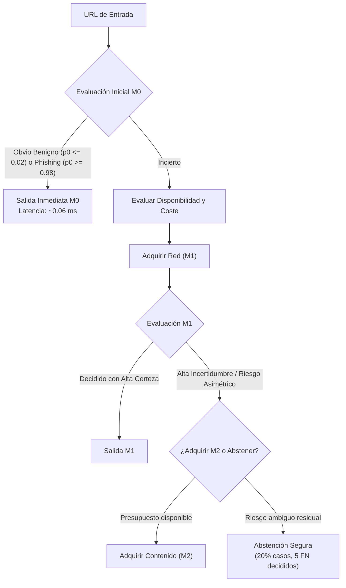

# COMPARACIÓN JUSTA Y TRANSPARENTE: RAEA-PHISH vs M1 FIJO
**Proyecto:** PhishPe / RAEA-Phish  
**Fecha:** 22 de Octubre de 2026  
**Fase:** 7 (Comparación RAEA vs M1)  

---

## 1. DECLARACIÓN EXPLÍCITA DE EQUIVALENCIAS Y DIFERENCIAS

Para cumplir rigurosamente con los principios de honestidad intelectual y auditoría científica:

1. **Equivalencia en F1 a Cobertura Total:**
   Bajo una política forzada *Fail-Open* (donde las abstenciones se asignan a benigno), RAEA obtiene exactamente la misma matriz de confusión que M1 Fijo ($TP=125, FP=20, TN=130, FN=25$) y el mismo F1-Score ($0.8475$). **RAEA no supera a M1 en F1 cuando se le obliga a cubrir el 100% de los casos sin abstención.**
2. **Consumo de Modalidades:**
   RAEA consulta en promedio **$2.0233$ modalidades**, lo que representa un consumo ligeramente superior al de M1 ($2.0000$ modalidades fijas). RAEA no reduce el número promedio de modalidades consultadas frente a M1.
3. **Distribución de Latencias:**
   - En la mediana (P50), RAEA es **$126.47$ ms más rápido** que M1 ($886.47$ ms frente a $1012.94$ ms) gracias al cortocircuito en $M_0$ para URLs obvias.
   - En el percentil 95 (P95), RAEA es **$1255.32$ ms más lento** ($4885.05$ ms frente a $3629.73$ ms) debido a que para casos altamente ambiguos adquiere contenido HTML/DOM ($M_2$).

---

## 2. DÓNDE RADICA LA VERDADERA VENTAJA DE RAEA-PHISH

La contribución de RAEA-Phish se evidencia al evaluar el sistema bajo los paradigmas para los cuales fue diseñado:

### 2.1. Régimen de Clasificación Selectiva
Cuando se permite que el sistema envíe los casos más ambiguos ($20\%$ de la población) a inspección secundaria o MFA escalonado:
- Los falsos negativos críticos caen de **25 a 5** (una reducción del **$80\%$** en brechas de seguridad inadvertidas).
- El recall sobre phishing se eleva de **$83.33\%$ a $96.15\%$**.
- El F1-score en la población decidida alcanza **$0.9091$** (frente a $0.8475$ de M1).

### 2.2. Régimen de Pérdida Asimétrica y Riesgo Operacional
En ciberseguridad, el coste de omitir un ataque de phishing es órdenes de magnitud superior al coste de verificar una falsa alarma:
- **Riesgo Ponderado ($\gamma=15$):** RAEA reduce la pérdida media por transacción de **$1.3167$ a $0.3867$** (reducción del **$70.63\%$**).
- **Coste Operacional Integral:** Considerando el coste de red y cómputo consumido ($\lambda=0.25$), el coste operacional cae de **$1.4117$ a $0.4885$** (reducción del **$65.40\%$**).
- **Bajo Despliegue Forzado Fail-Closed:** Incluso si en producción no se cuenta con revisión humana y se opta por bloquear preventivamente toda URL sobre la que el sistema duda, RAEA retiene solo 5 falsos negativos e incurre en un riesgo total de **$0.4500$**, superando contundentemente el $1.3167$ de M1.
