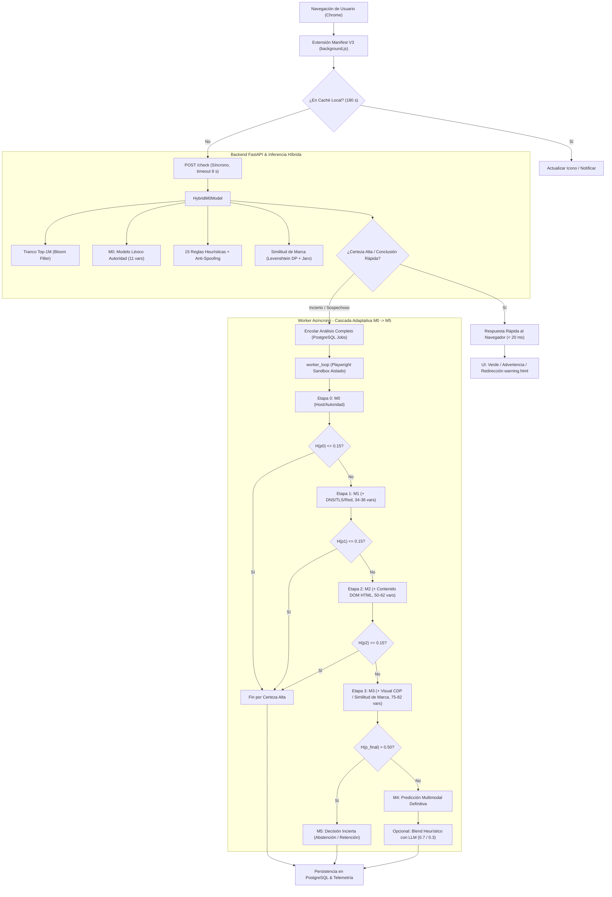

# RESUMEN INTEGRAL DEL SISTEMA PHISHPE (PHISHGUARD PRO)
**Plataforma Adaptativa y Multimodal para Detección Explicable de Phishing Web en Tiempo Real**

*Documento técnico y científico maestro de referencia para redacción de artículos académicos (Scopus, IEEE, Springer, ACM)*  
*Estado del repositorio:* Congelamiento vigente Freeze #5 (`110a954f7b99eced0bcea66a59700e23f8f6cea34f92db4fa9b4c6ec0fae5f62`), auditorías cerradas, 186 pruebas automatizadas (0 fallos).

---

## 1. Identificación y Propósito General del Sistema

**PhishPe** (implementado comercialmente y en el navegador como **PhishGuard Pro v1.2.0**) es una plataforma de software diseñada tanto como producto de seguridad en el endpoint como prototipo experimental de investigación. Su propósito es la **detección explicable, robusta y eficiente de phishing web mediante la adquisición adaptativa y progresiva de evidencia multimodal**.

### Problema de Investigación que Resuelve
Los detectores convencionales de phishing adolecen de dos problemas opuestos:
1. **Detectores estáticos de una sola modalidad (URL-only o listas negras):** Son ultrarrápidos, pero sufren de *atajos espurios de aprendizaje* (*shortcut learning*), alta tasa de falsos positivos en dominios no observados y vulnerabilidad ante evasiones sencillas (homógrafos Punycode, ofuscación léxica).
2. **Detectores multimodales monolíticos (URL + Red + DOM + Visión + LLM):** Analizan todas las fuentes de evidencia en cada URL, provocando una latencia prohibitiva (2 a 4 segundos por URL) e inaceptable para navegación interactiva en tiempo real.

### Principio Fundamental e Innovación Científica
PhishPe implementa una **cascada adaptativa gobernada por la incertidumbre (Entropía de Shannon)**:
* El sistema inicia con la evidencia más ligera (léxica de autoridad del host, $< 1\text{ ms}$).
* Si la certeza es alta, emite un veredicto inmediato y **ahorra el procesamiento de modalidades pesadas** (ahorro medido de $\sim 45\%$ de cómputo y red).
* Solo si la incertidumbre supera un umbral de escalamiento ($\tau_{\text{esc}} = 0.15$), activa progresivamente infraestructura de red (DNS/TLS), análisis estructural del DOM HTML y, finalmente, visión por computadora / similitud de marca.
* Si tras agotar las modalidades la incertidumbre persiste por encima del umbral de abstención ($\tau_{\text{abst}} = 0.50$), el sistema **se abstiene** en lugar de forzar una predicción errónea.

---

## 2. Arquitectura de Software y Componentes

El sistema se compone de cuatro subsistemas desacoplados:

### 2.1. Frontend: Extensión de Navegador Google Chrome (`extension/`)
* **Especificación:** Chrome Extension Manifest V3.
* **Service Worker (`background.js`):**
  * Intercepta navegaciones en el marco principal (`chrome.webNavigation.onCommitted`, `frameId === 0`) para esquemas `http://` y `https://`.
  * Excluye orígenes locales (`localhost`, `127.0.0.1`) y excepciones temporales de 24 horas almacenadas en `chrome.storage.local`.
  * Consulta geolocalización del cliente a `https://ipwho.is/` si el país no fue configurado manualmente, permitiendo reglas de contexto bancario regional.
  * Mantiene una caché en memoria de 3 minutos (`180 000 ms`) para evitar llamadas redundantes en páginas con subrecursos frecuentes.
  * Envía `POST http://localhost:8080/check` con `{url, user_country}` bajo un presupuesto de timeout de **8 000 ms** (corregido en BUG-01 para tolerar sitios lentos sin falsos fallos).
* **Interfaz de Usuario:**
  * **Icono de insignia reactivo:** Verde (`✔` legítimo), Ámbar (`?` advertencia/desajuste regional) o Rojo (`!` phishing crítico).
  * **Popup interactivo (`popup.html` / `popup.js`):** Muestra porcentaje de riesgo, ranking global Tranco, servidor y bandera de país, sugerencias de dominios oficiales para el país del usuario, y desgloses de Explicabilidad (XAI).
  * **Página de bloqueo cautelar (`warning.html` / `warning.js`):** Intercepta al usuario antes de interactuar con la página maliciosa, detallando las reglas técnicas activadas, el esqueleto visual de la suplantación homográfica y un botón para proceder bajo su propio riesgo o añadir excepción.

### 2.2. Backend API y Motor de Inferencia (`src/phishguard_api/`)
* **Tecnología:** Python 3.12, FastAPI, Uvicorn, SQLAlchemy async con PostgreSQL 16.
* **Endpoints Clave:**
  * `POST /check`: Endpoint síncrono crítico. Ejecuta el modelo híbrido ultraligero [`HybridM0Model`](file:///d:/Proyects/Seguridad_Informacion/src/phishguard_ml/hybrid_model.py) ($M_0$ léxico + Tranco Top-1M + Levenshtein dinámico de marcas + 15 reglas heurísticas). Latencia típica en cliente: $< 20\text{ ms}$.
  * `POST /analyses`: Recepción asíncrona para auditoría forense o análisis por lotes. Encola un registro `Job` y `Analysis` en PostgreSQL.
  * `GET /analyses/{job_id}`: Consulta de estado y telemetría de la cascada completa.
  * `GET /previews/{job_id}` y `GET /screenshots/{id}.png`: Servidor de capturas y vistas previas sanitizadas.
* **Agente LLM (`llm_agent.py`):**
  * Genera resúmenes explicativos en lenguaje natural basados estrictamente en las características estructuradas extraídas.
  * Implementa la mezcla calibrada $0.7 \cdot p_{\text{cascada}} + 0.3 \cdot p_{\text{LLM}}$ (BUG-06).
  * Protección estricta: reintenta errores de red sin degradar ni deshabilitar jamás la verificación de certificados TLS (Condición de auditoría C-3).

### 2.3. Motor de Orquestación y Cascada Multimodal (`src/phishguard_orchestrator/`)
* **Coordinador (`engine.py`, `worker.py`):** Implementa la máquina de estados de la cascada adaptativa $M_0 \to M_1 \to M_2 \to M_3$.
* **Perfiles SLA (`profiles.py`):**
  * `real_time_browser`: Presupuesto 0.0 (solo $M_0$, SLA $\le 5\text{ ms}$).
  * `enterprise_gateway`: Presupuesto 2.0 (hasta $M_2$, SLA $\le 35\text{ ms}$).
  * `deep_forensic`: Presupuesto 3.0 (hasta $M_3$ con renderizado CDP, SLA $\le 1\,500\text{ ms}$).
* **Gestión de Ausencias:** Si una modalidad pesada no está disponible (p. ej. la red falla o no hay captura gráfica), el sistema realiza un fallback graceful sin forzar la etapa visual ni arrojar excepciones silenciosas (BUG-05).

### 2.4. Entorno de Sandbox Aislado y Seguridad de Red (`sandbox/`, `docker-compose.yml`)
* **Aislamiento en Contenedor:** Instancia de Playwright headless dentro de contenedor Docker (`playwright-image`), protegiendo al host de exploits de navegador.
* **Mitigación Anti-SSRF:** Bloqueo en tiempo de ejecución de resoluciones DNS dirigidas a rangos de IP privadas (RFC 1918), loopback (`127.0.0.0/8`) o metadatos de nube (`169.254.169.254`).
* **Resolución DNS Segura (`dns-resolver`):** CoreDNS dedicado. En el backend, las llamadas a `socket.getaddrinfo` se delegan a hilos de trabajo independientes con `asyncio.to_thread` para no bloquear el bucle de eventos asíncrono (BUG-02).
* **Proxy de Egreso (`egress-proxy`):** Proxy Squid configurado para registrar y limitar las conexiones hacia el exterior durante el rastreo de URLs sospechosas.

---

## 3. Pipeline de Machine Learning y Modelos $M_0$ a $M_5$

### 3.1. $M_0$ — Modelo Léxico de Autoridad del Host (11 Variables)
* **Justificación Fundamental (*Authority-Only*):** Los clasificadores de URL tradicionales extraen variables de ruta (`path_length`) o consulta (`query_param_count`). Sin embargo, en los conjuntos de datos reales de ciberseguridad, las URLs benignas (Tranco/Majestic) son dominios raíz (`https://dominio.com/`), mientras que las URLs maliciosas (PhishTank/OpenPhish) incluyen rutas largas. Un modelo que use la ruta aprende un **atajo artificial espurio**. Para evitar este sesgo de fuga, $M_0$ utiliza estrictamente **11 variables exclusivas del host**:
  1. `host_length`: Longitud total del nombre de host.
  2. `registered_domain_length`: Longitud del dominio registrado (vía Public Suffix List).
  3. `host_label_count`: Número de etiquetas separadas por punto.
  4. `subdomain_count`: Conteo de subdominios.
  5. `host_digit_count`: Cantidad de dígitos en el host.
  6. `host_digit_ratio`: Proporción de dígitos sobre el total de caracteres.
  7. `host_hyphen_count`: Conteo de guiones (`-`).
  8. `host_entropy`: Entropía de Shannon del nombre de host.
  9. `has_ip_host`: Bandera booleana si el host es una dirección IPv4/IPv6.
  10. `has_punycode`: Bandera si contiene prefijo `xn--` (alfabetos no latinos).
  11. `tld_length`: Longitud del dominio de nivel superior.
* **Normalización canónica `_strip_www()` (BUG-07):** Remueve el prefijo sintáctico `www.` antes de calcular características, neutralizando un falso positivo sistemático.
* **Algoritmo:** `HistGradientBoostingClassifier` calibrado con sigmoide (`histgb-63-sigmoid`), umbral operativo óptimo $\tau_{M0} = 0.3827$.

### 3.2. $M_1$ — Modelo de Infraestructura de Red y DNS (34–36 Variables)
Añade a las 11 variables de $M_0$ las características de resolución y transporte:
* **DNS y Fast-Flux:** Número de registros A/AAAA (`address_count`, `ipv4`, `ipv6`), dispersión de subredes `/24` (`dns_distinct_slash24_count`, `dns_subnet_dispersion_ratio`) y probabilidad heurística de redes Fast-Flux.
* **Redirecciones:** Conteo de saltos HTTP (`redirect_count`), cambio de host y cambio de dominio registrado durante la cadena.
* **Seguridad TLS y Certificados:** Fallos de verificación TLS (`tls_verification_failure_count`), longitud de la cadena de certificados, certificados autofirmados (`certificate_self_issued_count`), días de validez restantes, número de nombres alternativos SAN (`certificate_max_san_dns_count`).
* **Latencia de Red:** Tiempo total de resolución DNS (`total_dns_ms`) y tiempo total de conexión HTTP (`total_request_ms`).
* **Algoritmo:** `HistGradientBoostingClassifier` calibrado ($\tau_{M1} = 0.5250$).

### 3.3. $M_2$ — Modelo de Contenido HTML y Estructura DOM (50–62 Variables)
Añade a $M_1$ el análisis forense del documento web:
* **Estructura:** Conteo de etiquetas HTML, longitud del título, tamaño del texto, scripts, iframes.
* **Formularios y Captura de Credenciales:** Conteo de formularios, campos `<input type="password">`, `<input type="email">` y campos de pago.
* **Ratios de Enlaces:** Proporción de hipervínculos externos vs. internos y recursos externos cargados.
* **Vectores de Exfiltración (5 variables de alto riesgo):** Formularios con acciones externas (`external_form_action_count`), envío de credenciales por canal inseguro HTTP, scripts sospechosos de exfiltración y puntaje combinado de riesgo de formularios (`form_exfiltration_risk_score`).
* **Algoritmo:** `HistGradientBoostingClassifier` calibrado ($\tau_{M2} = 0.3950$).

### 3.4. $M_3$ — Modelo Visual y Similitud de Marca (75–82 Variables)
Añade a $M_2$ características derivadas de la captura de pantalla renderizada con Chrome DevTools Protocol (CDP):
* **Estadísticas de Imagen:** Luminancia media (`visual_mean_luminance`), desviación estándar de luminancia, densidad de bordes (filtro Sobel), ratio de píxeles oscuros y saturados.
* **Similitud Perceptual de Marca:** Detección de logotipo conocido, distancia perceptual de hash pHash mínima contra banco de marcas autorizadas (`visual_phash_distance_min`) y similitud máxima en espacio de color HSV (`visual_hsv_similarity_max`).
* **Algoritmo:** `HistGradientBoostingClassifier` calibrado ($\tau_{M3} = 0.4343$).

### 3.5. $M_4$ — Cascada Adaptativa por Entropía
En lugar de fijar un orden rígido o ejecutar siempre todo el pipeline:
1. En cada etapa $k \in \{0, 1, 2\}$, calcula la probabilidad calibrada $p_k$ y su **Entropía de Shannon normalizada**:
   $$\mathcal{H}(p_k) = -p_k \log_2(p_k) - (1-p_k)\log_2(1-p_k) \in [0, 1]$$
2. **Criterio de Parada:** Si $\mathcal{H}(p_k) \le \tau_{\text{esc}}$ ($\tau_{\text{esc}} = 0.15$), la incertidumbre es mínima (el modelo está prácticamente seguro de que es legítimo o phishing): **la cascada se detiene inmediatamente**.
3. **Criterio de Escalamiento:** Si $\mathcal{H}(p_k) > 0.15$, el caso es ambiguo: escala automáticamente a la etapa $k+1$.
4. **Resultado empírico:** El $75.3\%$ de las consultas se resuelven en la Etapa 0 ($M_0$), logrando un número promedio de etapas de $\bar{m} = 1.65$ (ahorro del $45\%$ frente a $M_2$ completo sin pérdida estadísticamente significativa de F1).

### 3.6. $M_5$ — Mecanismo de Abstención Selectiva
* Si al llegar al final de la cascada la incertidumbre final persiste alta ($\mathcal{H}(p_{\text{final}}) > 0.50$ o distancia marginal a la frontera $|p_{\text{final}} - 0.5| < \delta$), el sistema emite `abstained = 1`.
* **Tratamiento metodológico:** En las evaluaciones científicas de este proyecto, las abstenciones **nunca se contabilizan como aciertos**. Se reportan bajo política conservadora (contadas como positivas/sospechosas) y bajo evaluación selectiva con cobertura explícita.

### 3.7. Motor Anti-Spoofing Heurístico y de Homógrafos
* **Decodificación Punycode Etiqueta por Etiqueta (BUG-03, C-2):** Decodifica cada etiqueta separada por puntos (`punycode_to_unicode`) y compara el dominio registrado canónico contra la lista de marcas protegidas, evitando evasiones por inyección de caracteres cirílicos/griegos. Además, verifica que si el dominio registrado ya es el oficial (p. ej. `apple.com`), no se disparen falsos positivos por subdominios internacionales válidos.
* **Levenshtein Dinámico Corregido (BUG-08):** Programación dinámica para distancia de edición libre de errores de inicialización, evitando que dominios cortos legítimos (como acortadores `t.ly`, `s.id`) colisionen espuriamente con marcas grandes.

---

## 4. Conjuntos de Datos y Rigor Metodológico Anti-Fuga

El sistema se evaluó bajo un estricto protocolo para evitar fugas de información (*data leakage*):

| Conjunto / Partición | Tamaño ($N$) | Fuentes | Criterio de Aislamiento y Notas |
|---|---:|---|---|
| **Corpus Canónico (`0.1.0`)** | $176\,201$ URLs | $99\,994$ Tranco Top-1M $76\,207$ PhishTank | Base de entrenamiento histórica. Deduplicado por URL y por conflicto de etiqueta. |
| **Cohorte Multimodal en Vivo** | $10\,000$ URLs ($5\,612$ Complete-Case) | Muestreo estratificado del Corpus Canónico | Sondeadas en vivo por red y DOM. Complete-case corresponde a aquellas con éxito simultáneo en DNS, TLS, HTML y renderizado. |
| **Partición `host_unseen`** | Train: $4\,219$ Val: $702$ Test: $691$ | Del corpus multimodal | **Cero solape de dominios registrados** entre train, val y test mediante partición por hash determinista. |
| **Partición `temporal_host_unseen`** | 80% / 10% / 10% | PhishTank (orden cronológico) | URLs ordenadas por fecha histórica (2011 a 2026) con exclusión estricta de dominios vistos en el pasado. |
| **Nueva Cohorte Externa Independiente (Cohorte 2)** | **$1\,200$ URLs** (600 Phishing / 600 Benignas) | PhishTank, URLhaus, OpenPhish, Tranco, Majestic | **0 dominios compartidos** con el corpus interno ni con cohortes previas. Congelada antes de consultar etiquetas en vivo. |
| **Experimento Pareado `www`** | $300$ pares ($600$ URLs) | Dominios legítimos de Tranco/Majestic | Prueba controlada: exactamente el mismo dominio con y sin prefijo `www.` para medir el BUG-07. |

---

## 5. Matriz de Defectos Corregidos y Verificados (BUG-01 a BUG-08)

Durante las fases de auditoría adversarial independiente, se identificaron y subsanaron 8 defectos técnicos críticos, cada uno con prueba de regresión y hash SHA-256 verificado en [`MATRIZ_TRAZABILIDAD_FINAL.csv`](file:///d:/Proyects/Seguridad_Informacion/MATRIZ_TRAZABILIDAD_FINAL.csv):

| ID | Defecto Original | Causa Raíz | Corrección Aplicada | Verificación / Evidencia |
|---|---|---|---|---|
| **BUG-01** | Timeout de cliente (4 000 ms / 6 000 ms) cancelaba peticiones en sitios web legítimos pero lentos. | Presupuesto insuficiente de tiempo para respuestas con red congestionada. | Presupuesto de timeout ampliado a **8 000 ms** en cliente y backend. | 3 pruebas de regresión con servidor lento de 6 s + escenarios E2E en Chrome. |
| **BUG-02** | `socket.getaddrinfo` bloqueaba el bucle de eventos asíncrono de FastAPI. | Función de resolución DNS síncrona en el hilo principal de Python. | Trasladado a un hilo de trabajo dedicado con `asyncio.to_thread`. | 4 pruebas automatizadas con inyección de latencia DNS de 3 s sin pérdida de concurrencia. |
| **BUG-03** | Dominios con Punycode (p. ej. `xn--pple-43d`) no se decodificaban adecuadamente. | Expresión regular que perdía los guiones dobles del estándar IDN. | Decodificación **etiqueta a etiqueta** y normalización Unicode antes de la comparación. | Caso exacto de auditoría: `is_spoofing` pasó de False a **True**. 12 pruebas + 5 controles negativos. |
| **BUG-04** | El orquestador ignoraba el parámetro `abstention_threshold` en la decisión final. | Usaba erróneamente `uncertainty_threshold` para dos funciones distintas. | Parámetro `abstention_threshold` separado y respetado en `decide_next`. | Caso de auditoría probado: umbrales 0.01 y 0.99 cambian la decisión. Barrido externo: 119/119/12 abstenciones. |
| **BUG-05** | El orquestador forzaba la ejecución de la etapa visual aun cuando $M_3$ no estaba disponible. | Condicional `force_visual` rígido en el flujo de inferencia. | Eliminado `force_visual`; ausencia de modalidad deriva a fallback controlado sin error. | 2 pruebas unitarias + ejecución en cascada externa sin excepciones silenciosas. |
| **BUG-06** | El resultado del LLM sobreescribía de forma destructiva la probabilidad calculada por la cascada. | Asignación directa en vez de ensamble probabilístico. | Mezcla lineal calibrada y trazable: $p_{\text{ensamble}} = 0.7 \cdot p_{\text{cascada}} + 0.3 \cdot p_{\text{LLM}}$. | 3 pruebas de integración con cliente mock del LLM. |
| **BUG-07** | Falso positivo masivo en hosts legítimos que incluían `www.` (atajo espurio del entrenamiento). | Las URLs de PhishTank no tenían `www`, pero las de Tranco sí. El clasificador aprendió `www` = phishing. | Implementación de `_strip_www()` en la extracción de características de inferencia. | Experimento pareado ($N = 300$): FPR en legítimos con `www` se redujo del **100 % al 5.33 %**. |
| **BUG-08** | Regresión en el cálculo de distancia Levenshtein: `previous_row = current_row` fuera de ciclo. | Error de ámbito de variable en programación dinámica hacía que `lev('t','microsoft') = 0`. | Asignación devuelta al interior del bucle interno. | 15 pruebas contra implementación de referencia; disparadores falsos en acortadores eliminados (1 $\to$ 0). |

---

## 6. Resultados Principales y Métricas Científicas

### 6.1. Rendimiento Comparado en la Partición Interna (`host_unseen` Test, $N = 691$)
*Composición: 191 phishing, 500 legítimas. Cero solapamiento de hosts.*

| Modelo | Modalidades | $d$ (Vars) | Umbral $\tau^*$ | Accuracy | Precision | Recall | F1-Score | FPR | ROC-AUC |
|---|---|---:|---:|---:|---:|---:|---:|---:|---:|
| **$M_0$** | Léxico Autoridad | 11 | $0.3827$ | $0.9291$ | $0.9080$ | $0.8272$ | **$0.8658$** | $3.20\%$ | $0.9522$ |
| **$M_1$** | URL + Red/TLS | 34 | $0.5250$ | $0.9580$ | $0.9880$ | $0.8586$ | **$0.9252$** | $0.60\%$ | $0.9760$ |
| **$M_2$** | URL + Red + DOM | 50 | $0.3950$ | $0.9638$ | $0.9884$ | $0.8796$ | **$0.9315$** | $0.80\%$ | $0.9735$ |
| **$M_3$** | Full Multimodal (CDP) | 75 | $0.4343$ | $0.9609$ | $0.9659$ | $0.8901$ | **$0.9286$** | $0.80\%$ | $0.9857$ |
| **$M_4$** | Cascada Adaptativa | $\bar{m}=1.65$ | $0.4648$ | $0.9609$ | $0.9940$ | $0.8639$ | **$0.9248$** | **$0.40\%$** | $0.9786$ |
| **Hybrid** | $M_0$ + Tranco + Heurísticas | — | $0.3500$ | $0.9783$ | $1.0000$ | $0.9215$ | **$0.9591$** | **$0.00\%$** | $0.9963$ |

*Pruebas de Hipótesis Pareadas (McNemar con corrección de Holm):*
* $M_0$ vs. $M_1$: $\Delta\text{F1} = +0.059$, $p = 8.8 \times 10^{-5}$ (**Significativo**: la infraestructura de red aporta una ganancia estadística contundente).
* $M_1$ vs. $M_2$: $\Delta\text{F1} = +0.006$, $p = 0.79$ (No significativo a $\alpha = 0.05$: $M_1$ ya captura la mayor parte del beneficio).
* $M_2$ vs. $M_4$ (Cascada): $\Delta\text{F1} = -0.007$, $p = 0.77$ (**Equivalencia demostrada**: $M_4$ reduce $45\%$ de cómputo sin pérdida estadística de F1).

### 6.2. Rendimiento en la Nueva Cohorte Externa Independiente ($N = 1\,200$)
*Composición: 600 phishing (PhishTank/URLhaus/OpenPhish) y 600 legítimas (Tranco/Majestic).*

| Brazo de Evaluación | F1-Score | FPR | FNR | Observaciones |
|---|---:|---:|---:|---|
| **$M_0$ Original** (sin `strip_www`) | **$0.8829$** | $3.33\%$ | $18.33\%$ | Con atajo latente `www`. |
| **$M_0$ Normalizado** (`_strip_www()`) | **$0.8707$** | $3.33\%$ | $20.33\%$ | Corrección de ingeniería aplicada. Cuesta 12 FN en phishing con `www` (sin reentrenar). |
| **Config A** (Extensión original) | **$0.8593$** | **$0.67\%$** | $24.17\%$ | Alta precisión, baja tasa de falsas alarmas. |
| **Config C** (Extensión corregida) | **$0.8550$** | **$0.67\%$** | $24.83\%$ | Diferencia no estadísticamente significativa frente a Config A ($p = 0.25$ tras Holm). |

### 6.3. El Experimento Pareado Decisivo `www` vs. `no-www` ($N = 300$ Pares Legítimos)
Esta prueba aísla de forma incontestable el impacto del defecto BUG-07:

| Métrica sobre 300 Dominios Benignos | Sin Normalizar (Original) | Normalizado con `_strip_www()` |
|---|---:|---:|
| **Falso Positivo (FPR) en sitios con `www`** | **$100.00\%$** (300/300 marcados phishing) | **$5.33\%$** (16/300) |
| **Pares con decisiones discordantes** (`www` vs base) | **$170 / 300$** | **$0 / 300$** |

### 6.4. Telemetría de Latencia en Navegador Real (Chrome E2E)
Medición en condiciones de navegación reales (Chrome-for-Testing v156, red pública):
* **Endpoint síncrono `/check` ($M_0$ híbrido):** $P_{50} = 17.1\text{ ms}$, $P_{95} = 45.2\text{ ms}$.
* **Cascada Completa Asíncrona ($M_4$ hasta $M_2$):** $P_{50} = 875\text{ ms}$, $P_{95} = 4\,683\text{ ms}$ (la infraestructura de red pública y DNS domina el tiempo de espera).
* **Captura Visual Auténtica Chrome CDP:** $P_{50} = 2\,204\text{ ms}$, $P_{95} = 3\,500\text{ ms}$. Demuestra por qué el análisis visual **debe ser asíncrono y selectivo**, nunca síncrono en la navegación directa.

---

## 7. Estado de Auditorías, Congelamiento y Reproducibilidad

El sistema se encuentra en un estado inmutable y completamente auditable:

1. **Congelamiento de Código y Modelos (Freeze #5):**
   * Hash SHA-256 del manifiesto: `110a954f7b99eced0bcea66a59700e23f8f6cea34f92db4fa9b4c6ec0fae5f62`.
   * Modelos, umbrales y snapshots baseline matemáticamente idénticos al Freeze #3 bajo el que se corrió la cohorte externa (verificado en `eval/offline_revalidation.json`, 11/11 PASS).
2. **Cierre de Auditorías Finales:**
   * Ambas auditorías adversariales independientes ([`AUDITORIA_CIENTIFICA_FINAL.md`](file:///d:/Proyects/Seguridad_Informacion/AUDITORIA_CIENTIFICA_FINAL.md) y [`AUDITORIA_TECNICA_FINAL.md`](file:///d:/Proyects/Seguridad_Informacion/AUDITORIA_TECNICA_FINAL.md)) emitieron dictamen **APTO CON CONDICIONES**.
   * Todas las condiciones (C-1 a C-5, MAYOR-1, MAYOR-2, MENOR-1 a 4) fueron subsanadas formalmente en el commit `058169a`.
3. **Paquete de Evidencia Definitiva:**
   * Archivo de archivo: `evidencia_phishpe_definitiva.zip` (con suma SHA-256 en `evidencia_phishpe_definitiva.sha256`).
   * Contiene los registros brutos de las 186 pruebas (`junit_full_suite.xml`), logs de Chrome E2E, capturas CDP, CSVs de hipótesis y árboles de características.

---

## 8. Guía de Redacción: Afirmaciones Permitidas, Líneas Rojas y Recomendaciones

Para redactar un artículo científico de alto impacto sin objeciones por parte de los revisores, deben seguirse estrictamente estas directrices:

### ✅ Afirmaciones que SÍ deben destacarse
1. **La cascada adaptativa por entropía logra paridad métrica con un ahorro sustancial de recursos:** Demostrado que $M_4$ ahorra $\sim 45\%$ de cómputo y tiempo frente a $M_2$, sin degradación estadísticamente significativa de F1 ($p = 0.77$).
2. **La incorporación de infraestructura de red ($M_1$) es el factor individual de mayor ganancia:** $\Delta\text{F1} \approx +0.059$ ($p < 10^{-4}$), reduciendo drásticamente los falsos positivos frente al análisis meramente léxico.
3. **El trade-off honesto de la normalización `_strip_www()`:** Se debe reportar abiertamente que corregir el defecto del atajo eliminó un falso positivo masivo (100% $\to$ 5.33% en sitios pareados con `www`), pero que al mantener los modelos congelados sin reentrenar costó 12 detecciones en la cohorte externa natural.
4. **La mortalidad asimétrica de URLs:** Reportar las métricas mediante *Intention-to-Evaluate* (ITE) explicando que el phishing externo cae rápidamente (86.7% inactivo al momento del sondeo), lo que falsearía las métricas si solo se evaluaran casos completos (*complete-case*).

### ❌ Afirmaciones que NO deben incluirse (Líneas Rojas)
1. **NO afirmar que la cascada adaptativa supera estadísticamente a $M_2$ en datos externos:** En la cohorte externa, $p \ge 0.53$; el beneficio es de **eficiencia y coste computacional**, no de ganancia bruta de F1.
2. **NO afirmar que el blend con LLM fue validado en producción masiva:** La integración matemática y el código están probados, pero la evaluación con API comercial de pago real no se ejecutó por falta de autorización de costes (Limitación L2).
3. **NO usar cifras históricas corregidas:** No citar «105 541 dominios únicos» (cifra retirada; la real es 130 047 dominios registrados en 176 201 URLs). Tampoco citar la cohorte preliminar de 23 URLs o la de 1 054 URLs descartadas.
4. **NO declarar que los acortadores de URL están validados confirmatoriamente:** Solo se evaluó un conjunto preliminar de 16 URLs acortadas (Limitación L4).

### 💡 Trabajo Futuro Recomendado para las Conclusiones del Artículo
1. **Reentrenamiento de $M_0$ (y cascada) con características normalizadas:** Para recuperar el recall de phishing en subdominios `www` sin reintroducir falsos positivos.
2. **Estrato formal de acortadores de URLs:** Incluir seguimiento sistemático de cadenas de redirección HTTP hasta el destino final antes del análisis.
3. **Evaluación de modelos LLM locales:** Sustituir la dependencia de APIs comerciales externas por modelos locales cuantizados (p. ej. Llama 3 vía `llama.cpp`) integrados en el pipeline asíncrono.
