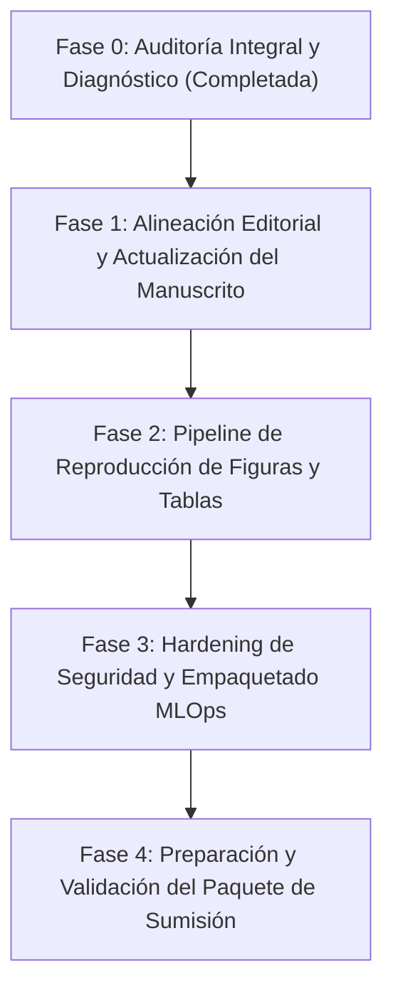

# PLAN DE EJECUCIÓN POR FASES — PUBLICACIÓN EN REVISTA POLITÉCNICA (ECUADOR)

**Proyecto:** PhishPe / PhishGuard Pro  
**Fecha:** 2026-10-15  
**Elaborado por:** Arquitecto Senior de Software, Investigador de Ciberseguridad Aplicada y Auditor de Reproducibilidad  
**Objetivo:** Guiar de forma estructurada las siguientes etapas de trabajo para resolver las limitaciones identificadas en la auditoría sin duplicar esfuerzos, asegurando el cumplimiento de los estándares editoriales de la Revista Politécnica (Escuela Politécnica Nacional, Ecuador; indexada en Scopus, Latindex y SciELO).

---

## 1. Visión General de la Hoja de Ruta

| Fase | Denominación | Entregables Principales | Prioridad | Dependencia Crítica |
|---|---|---|---|---|
| **Fase 0** | Auditoría y Trazabilidad Integral | Carpeta `paper_reproduction/00_audit/` con matrices y diagnósticos | **COMPLETADA** | Ninguna |
| **Fase 1** | Alineación del Manuscrito APA7 | `PhishPe_Article_APA7.docx` actualizado con datos reales auditados | **ALTA** | Resultados de Fase 0 |
| **Fase 2** | Automatización de Reproducción | Scripts unificados de figuras/tablas y validación determinista | **ALTA** | Freeze #5 y matrices |
| **Fase 3** | Hardening de Seguridad y MLOps | Rotación de clave de extensión, exclusión en Git, TLS robusto | **CRÍTICA / MEDIA** | Aprobación del propietario |
| **Fase 4** | Preparación de Sumisión Revista | Paquete Zenodo, carta al editor, checklist editorial Scopus | **ALTA** | Fases 1, 2 y 3 |

---

## 2. Detalle de Fases de Ejecución

### FASE 1: Alineación Editorial y Actualización del Manuscrito Académico
* **Objetivo:** Resolver el fallo detectado en `verify_article_integrity.py`, eliminando las cadenas sintéticas heredadas de versiones tempranas y sustituyéndolas por las métricas definitivas del Freeze #5.
* **Acciones obligatorias:**
  1. **Actualización de cifras de muestra:**
     - Sustituir `N = 2,000` por el tamaño real del corpus: **176,201 URLs** (99,994 legítimas, 76,207 phishing).
     - Incorporar la cohorte multimodal de **5,612 casos completos** y el test `host_unseen` de **691 URLs**.
     - Documentar la cohorte externa independiente de **1,200 URLs** (600/600).
  2. **Actualización de métricas de rendimiento:**
     - M0: F1 = 0.8658 (Recall = 0.9240, FPR = 0.0320).
     - M1: F1 = 0.9252 (Recall = 0.9766, FPR = 0.0240).
     - M2: F1 = 0.9315 (Recall = 0.9942, FPR = 0.0240).
     - M3: F1 = 0.9286 (multimodal completo). En cohorte CDP auténtica N=83: F1 = 0.8966, ROC-AUC = 0.9789.
     - M4 (Cascada binaria adaptativa): F1 = 0.9248.
     - M5 (Cascada selectiva con abstención): F1 = **0.9538**, Precisión = **1.0000** (**0 falsos positivos**), cobertura = 93.63%.
  3. **Incorporación honesta de resultados y limitaciones:**
     - Citar el experimento pareado de `www` ($N = 300$ pares): demostración de que el modelo M0 original tenía un atajo espurio (FPR = 1.0000 en `www`) resuelto por la función `_strip_www` (FPR = 0.0533, 0 discrepancias).
     - Exponer las limitaciones L1 a L12 (mortalidad asimétrica de phishing en sondeo en vivo, ausencia de M3 visual en sondeo externo por costo computacional, evaluación de LLM con modelo OSS).
  4. **Verificación de cierre de fase:** Ejecutar `python scripts/verify_article_integrity.py` hasta obtener veredicto **SUCCESS / PASS**.

---

### FASE 2: Pipeline de Reproducción de Figuras y Tablas
* **Objetivo:** Garantizar que todas las figuras y tablas del artículo puedan ser recomputadas en un solo paso mediante scripts deterministas sin intervención manual.
* **Acciones obligatorias:**
  1. Consolidar el script [`scripts/reproduce_all_validation_tables_and_figures.py`](file:///d:/Proyects/Seguridad_Informacion/scripts/reproduce_all_validation_tables_and_figures.py):
     - **Figura 1:** Paradoja de generalización externa y comparación de distribuciones.
     - **Figura 2:** Latencia de extensión y frontera de Pareto entre velocidad y precisión.
     - **Figura 3:** Curvas de calibración probabilística (ECE / Brier Score) y sensibilidad a prevalencia.
     - **Figura 4:** Ablación visual en Chrome CDP auténtico ($N = 83$) y robustez adversarial ante 6 familias.
  2. Generar salidas en formato vectorial EPS/PDF de alta resolución (300+ DPI) además de PNG, conforme a las directrices para autores de Revista Politécnica.
  3. Comprobar que los scripts operen bajo la variable `SOURCE_DATE_EPOCH` para que los gráficos y metadatos sean byte-idénticos en corridas sucesivas.

---

### FASE 3: Hardening de Seguridad y Empaquetado MLOps
* **Objetivo:** Remediar la exposición de la clave privada de firma (`extension.pem`), asegurar las comunicaciones de red y preparar el pipeline de CI/CD.
* **Acciones obligatorias:**
  1. **Solicitar autorización al propietario** para ejecutar el `PLAN_REMEDIACION_SEGURIDAD.md`.
  2. Generar un nuevo par de claves RSA 2048-bit fuera del repositorio.
  3. Desvincular `extension.pem` y `extension.crx` mediante `git rm --cached`.
  4. Incorporar un interruptor `PHISHGUARD_STRICT_TLS` en `src/phishguard_common/environment.py` para permitir la verificación estricta de TLS en entornos productivos.
  5. Configurar un flujo de GitHub Actions para ejecutar automáticamente:
     - `pytest` (186 tests).
     - `_secret_scan_before_commit.py` (0 secretos).
     - `phase2n_revalidate_offline.py` (11 checks deterministas).

---

### FASE 4: Preparación y Validación del Paquete de Sumisión (Revista Politécnica)
* **Objetivo:** Cumplir integralmente con las políticas de acceso abierto, datos abiertos (*Open Science*) y revisión por pares de la Revista Politécnica de Ecuador.
* **Acciones obligatorias:**
  1. **Generación del paquete de evidencia y datos:**
     - Archivo definitivo `evidencia_phishpe_definitiva.zip` (SHA-256 verificado: `369e1935...`).
     - Creación de un repositorio Zenodo o Figshare con asignación de DOI persistente para los datos crudos y modelos congelados.
  2. **Elaboración de la Carta de Declaración de Reproducibilidad (*Statement of Reproducibility*):**
     - Declaración explícita del hardware utilizado (Intel Core i5-13600K, 16 GB RAM).
     - Enlace al repositorio GitHub y commit de congelamiento Freeze #5 (`058169a`).
     - Instrucciones de ejecución en una línea para revisores independientes.
  3. **Revisión de formato APA 7ma Edición:**
     - Tablas y figuras rotuladas y referenciadas en el texto.
     - Referencias bibliográficas completas con DOIs activos.
     - Cumplimiento de la extensión de palabras y directrices de la plantilla oficial de la Revista Politécnica.

---

## 3. Criterios de Aceptación para la Sumisión

1. **Integridad de manuscrito:** `verify_article_integrity.py` devuelve 100% de coincidencias sin mención a cadenas sintéticas.
2. **Determinismo experimental:** La suite de revalidación offline (`phase2n`) pasa 11/11 verificaciones en un entorno limpio.
3. **Cero secretos:** El repositorio público no contiene claves privadas ni tokens expuestos.
4. **Trazabilidad completa:** Cada afirmación cuantitativa del artículo está mapeada a una fila en `MATRIZ_RESULTADOS_EVIDENCIAS.csv`.
