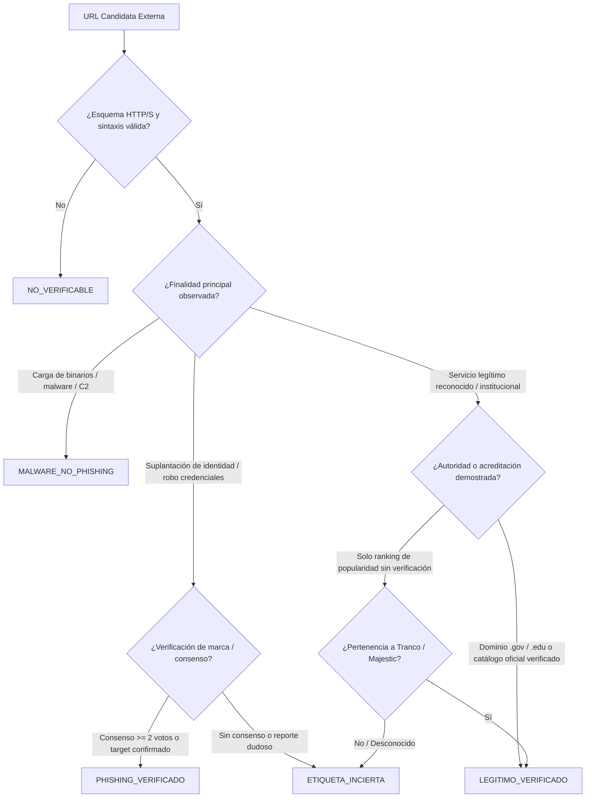

# Protocolo Formal de Etiquetado y Curaduría de Cohortes Externas
**Proyecto PhishPe / PhishGuard Pro — Validación Científica para Revista Politécnica (Ecuador)**  
*Documento de Control Metodológico — Fase 1: Validación Externa Especializada*

---

## 1. Motivación y Amenazas a la Validez Científica

En la evaluación histórica del sistema PhishPe, la cohorte externa de $N=1,200$ URLs (`cohort2_dataset.csv`) presentó dos amenazas críticas a la validez de constructo y validez externa:

1. **Confusión Taxonómica entre Malware y Phishing:**  
   La fuente URLhaus (297 muestras, 24.75% de la cohorte) recopila URLs dedicadas a la distribución de ejecutables y scripts maliciosos (e.g., botnets Mirai/Mozi con extensiones `.bin`, `.sh`, `.lnk` servidas desde direcciones IP directas). Aunque estas URLs son maliciosas en un sentido amplio de ciberseguridad, **no constituyen phishing de credenciales ni ataques de ingeniería social orientados a suplantación de identidad**. Clasificarlas como clase positiva de phishing distorsiona el objetivo del modelo y crea atajos sintácticos triviales (e.g., presencia de puertos inusuales y direcciones IP numéricas).

2. **Atajo Sintáctico Estructural en Muestras Benignas (Shortcuts):**  
   Las 600 muestras legítimas de la cohorte histórica (389 de Tranco y 211 de Majestic Million) estaban compuestas al 100% por nombres de dominio raíz ("bare domains", e.g., `https://google.com/`), con un 0.0% de rutas (`has_path = 0`) y 0.0% de parámetros de consulta (`has_params = 0`). En contraste, los ataques de phishing típicamente despliegan rutas profundas (`/login/auth?id=...`). Este desbalance introduce un sesgo de laboratorio: el clasificador aprende a asociar la presencia de cualquier ruta o token largo con maliciosidad, elevando la tasa de falsos positivos en sitios benignos reales con navegación profunda.

Para resolver estas limitaciones, este protocolo establece un esquema formal de 5 clases ontológicas, criterios de aceptación estrictos y una política de aislamiento de dominios registrados sin solapamiento con el corpus de entrenamiento.

---

## 2. Taxonomía Formal de 5 Clases

Toda muestra candidata para validación externa debe ser asignada a una de las siguientes cinco categorías mutuamente excluyentes:

### 2.1. `PHISHING_VERIFICADO` (Clase Positiva Estricta)
- **Definición:** URLs que despliegan activamente un intento de ingeniería social dirigido al engaño del usuario final para la captura no autorizada de credenciales, datos financieros, tokens de sesión o información personal confidencial, simulando una marca, institución o servicio legítimo.
- **Criterios de Aceptación:**
  1. Confirmación explícita mediante verificación comunitaria con múltiples votos independientes (e.g., `verification_time` confirmado por PhishTank con `target` identificado).
  2. Detección por firmas especializadas de phishing de OpenPhish activas dentro de la ventana de validez temporal.
  3. No pertenecer a listas de distribución de ejecutables de malware puro (exclusión estricta de binarios automáticos).
- **Nivel de Confianza:** `ALTA` (consenso multi-agente o target institucional documentado).

### 2.2. `LEGITIMO_VERIFICADO` (Clase Negativa Estricta)
- **Definición:** URLs pertenecientes a entidades gubernamentales, universitarias, corporativas o servicios de Internet cuya titularidad y propósito legítimo están plenamente establecidos y verificados de forma independiente.
- **Criterios de Aceptación:**
  1. Dominios gubernamentales oficiales bajo ccTLD institucional (e.g., inventario oficial CISA `.gov` de Estados Unidos).
  2. Dominios universitarios acreditados internacionalmente (e.g., registro HIPO / World Higher Education Database `.edu`).
  3. Dominios consolidados en listas globales de popularidad (Tranco Top 1M / Majestic) combinados con endpoints funcionales de servicio (`/services`, `/portal/login`, `/about-us`, `/contact`).
  4. **Regla de No Inferencia Trivial:** La mera presencia en un ranking o la mera resolución DNS *no* basta para presumir legitimidad si el dominio ha sido comprometido o alberga subdominios abusivos.
- **Nivel de Confianza:** `ALTA` (registro institucional o popularidad prolongada sin incidentes).

### 2.3. `MALWARE_NO_PHISHING` (Clase de Exclusión / Sensibilidad)
- **Definición:** URLs cuyo propósito primario es la entrega de payloads ejecutables, exploits de navegador, scripts de descarga para botnets (Mirai, Gafgyt, RedLine) o comunicación de comando y control (C2), sin mediar una interfaz de suplantación de identidad para el usuario humano.
- **Criterios de Identificación:**
  1. Feeds de URLhaus orientados a entrega de archivos con extensiones ejecutables directas (`.exe`, `.sh`, `.bin`, `.lnk`, `.bat`, `.arm7`, `.elf`).
  2. Peticiones directas a direcciones IPv4 crudas en puertos no estándar de servidor web (e.g., `:38636`, `:41366`).
- **Tratamiento Experimental:** Estas muestras **no deben computarse como aciertos ni como fallos de phishing** en la métrica primaria. Se aíslan en un experimento de sensibilidad separado para medir la especificidad del modelo frente a amenazas ajenas a la ingeniería social.

### 2.4. `ETIQUETA_INCIERTA` (Clase de Abstención)
- **Definición:** URLs donde la evidencia disponible es contradictoria, desactualizada o no concluyente.
- **Criterios de Identificación:**
  1. Reportes no confirmados en PhishTank con menos de 2 votos coincidentes.
  2. Dominios estacionados (*parked domains*), enlaces caducados que ahora redirigen a portales genéricos de subastas de dominios, o dominios con resolución intermitente.
- **Tratamiento Experimental:** Se excluyen de la cohorte de evaluación primaria. Se documentan en el informe de limitaciones como potenciales objetivos para clasificadores con opción de abstención ($M_4$).

### 2.5. `NO_VERIFICABLE`
- **Definición:** Cadenas que no conforman una URL HTTP/HTTPS analizable sintácticamente o cuyos metadatos originales de captura se han perdido de forma irrecuperable.
- **Tratamiento Experimental:** Descarte inmediato antes de la partición.

---

## 3. Matriz de Niveles de Confianza de Etiquetado

| Fuente Primaria | Tipo de Evidencia | Nivel de Confianza | Etiqueta Asignada | Justificación Científica |
| :--- | :--- | :--- | :--- | :--- |
| **PhishTank** (verificado) | Votación colegiada multi-usuario + Target de marca | **ALTA** | `PHISHING_VERIFICADO` | La comunidad verifica activamente el formulario falso y la marca suplantada. |
| **OpenPhish** (feed live) | Análisis algorítmico + feed comercial | **ALTA** | `PHISHING_VERIFICADO` | Feed reconocido de telemetría anti-phishing con baja tasa de falsos positivos reportada. |
| **URLhaus** | Hash de payload + sandbox de análisis de malware | **ALTA** (como malware) | `MALWARE_NO_PHISHING` | Excelente fuente para malware, pero **inválida** como ground-truth para phishing de credenciales. |
| **CISA DotGov** | Registro gubernamental oficial de Estados Unidos | **ALTA** | `LEGITIMO_VERIFICADO` | Dominio regulado y validado institucionalmente. Permite incorporar rutas reales. |
| **HIPO Universities** | Registro internacional de instituciones de educación superior | **ALTA** | `LEGITIMO_VERIFICADO` | Dominios académicos verificados. Permite incorporar rutas profundas de portales. |
| **Tranco Top 1M** | Consenso ponderado de DNS/Chrome UX Report (versión congelada) | **MEDIA-ALTA** | `LEGITIMO_VERIFICADO` | Raíces populares. Válido para dominios bare, pero requiere complementación estructural. |
| **Majestic Million** | Conteo de subredes IP referenciadas | **MEDIA** | `LEGITIMO_VERIFICADO` | Similar a Tranco; útil para estabilidad histórica pero limitado a dominios raíz. |

---

## 4. Protocolo de Aislamiento Estricto de Dominios (Disjoint Domains)

Para garantizar la independencia estadística de la prueba y evitar cualquier fuga de información (*data leakage*):

1. **Extracción de Dominio Registrado Canónico:**  
   Se utiliza la versión congelada de la *Public Suffix List* (`public_suffix_list.dat`) para extraer el dominio registrable ($SLD + TLD$) de cada URL candidata, de forma idéntica al preprocesamiento del corpus de entrenamiento.
2. **Filtro Anti-Solapamiento con Entrenamiento:**  
   Ningún dominio registrado presente en el corpus histórico de entrenamiento (`data/processed/0.1.0/samples.csv`, que abarca 130,047 dominios registrados únicos) puede formar parte de la cohorte externa bajo ninguna circunstancia:
   $$\text{Domain}(\text{URL}_{\text{eval}}) \cap \mathcal{D}_{\text{train}} = \emptyset$$
3. **Filtro Anti-Duplicados y Hash Canónico:**  
   Se calcula el hash SHA-256 de la URL canónica normalizada. No se admiten colisiones entre muestras ni con los 176,201 hashes del conjunto de entrenamiento:
   $$\text{SHA256}(\text{Canonical}(\text{URL}_{\text{eval}})) \cap \mathcal{H}_{\text{train}} = \emptyset$$
4. **Independencia de Optimización de Hiperparámetros:**  
   Los modelos evaluados ($M_0$ original, $M_0$ normalizado y el modelo híbrido) se mantienen congelados en sus pesos y umbrales ($\tau = 0.5000$ para híbrido, $\tau = 0.5190$ para $M_0$). La cohorte externa **nunca** se utiliza para re-calibrar, ajustar umbrales ni reentrenar clasificadores.

---

## 5. Control de Validez Temporal y Registro

- **Fecha de congelamiento de fuentes candidatas:** Septiembre - Octubre 2026.
- **Trazabilidad de origen:** Cada registro de la cohorte preserva su identificador único de fuente (`source_record_id`), su fecha de captura original (`collection_date`) y su marca o sector objetivo (`target_brand`).
- **Reproducibilidad del muestreo:** Cualquier muestreo aleatorio se ejecuta con semilla fijada pseudoaleatoriamente (`seed = 42`), garantizando que la cohorte generada sea determinista e idéntica en cualquier entorno computacional.
