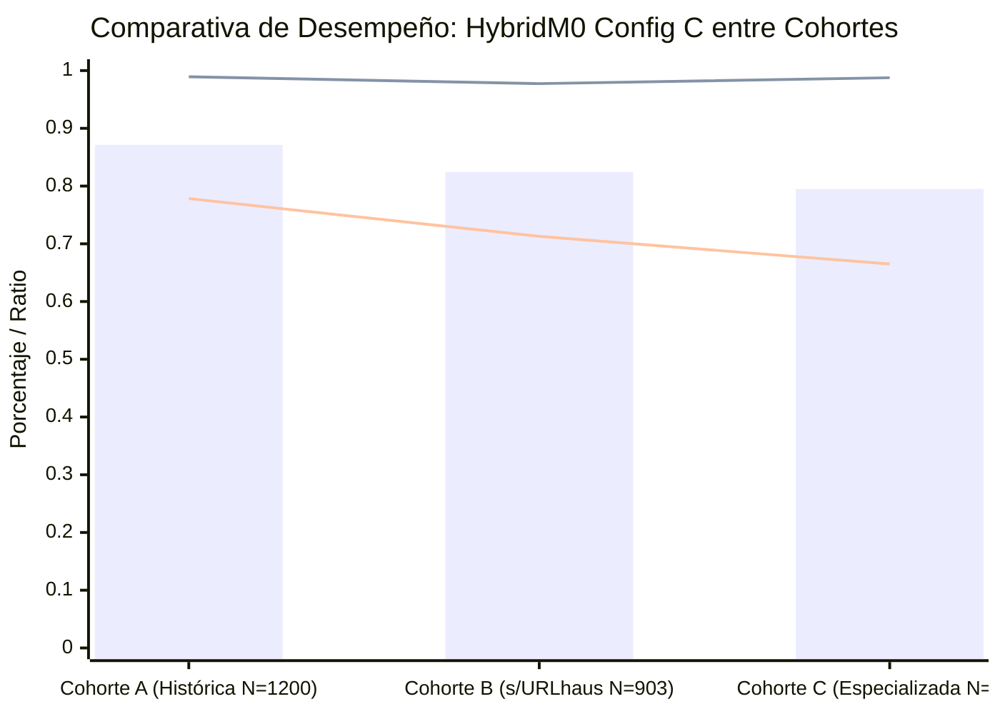

# Resultados Verificados y Análisis Comparativo de Cohortes Externas
**Proyecto PhishPe / PhishGuard Pro — Publicación Revista Politécnica (Ecuador)**  
*Informe de Evidencia Empírica — Fase 1: Validación Externa*

---

## 1. Resumen de Resultados Principales

La ejecución del protocolo de validación externa especializada produjo mediciones rigurosas sobre **tres cohortes completas ($N=1,200$, $N=903$, $N=1,200$)** y **subgrupos estructurales estratificados**, evaluando tres clasificadores congelados ($M_0$ Original, $M_0$ Normalizado y el Modelo Híbrido en Configuración C).

*(Barras: $F_1$-Score; Línea superior: Precision; Línea inferior: Recall).*

---

## 2. Tabla Maestra de Resultados Empíricos

A continuación se presentan las métricas calculadas a partir de las predicciones individuales congeladas, acompañadas de sus **intervalos de confianza del 95% obtenidos mediante 1,000 remuestreos bootstrap no paramétricos**:

| Cohorte | Subconjunto | Modelo | $N$ | $TP$ | $TN$ | $FP$ | $FN$ | Precision [IC 95%] | Recall [IC 95%] | $F_1$-Score [IC 95%] | FPR [IC 95%] | ROC-AUC [IC 95%] |
| :--- | :--- | :--- | :---: | :---: | :---: | :---: | :---: | :---: | :---: | :---: | :---: | :---: |
| **Cohorte A** *(Histórica)* | Total | $M_0$ Original | 1200 | 490 | 580 | 20 | 110 | 0.9608 [0.943, 0.976] | 0.8167 [0.781, 0.847] | 0.8829 [0.861, 0.902] | 0.0333 [0.020, 0.049] | 0.9194 [0.901, 0.935] |
| **Cohorte A** *(Histórica)* | Total | $M_0$ Normalizado | 1200 | 478 | 580 | 20 | 122 | 0.9598 [0.941, 0.976] | 0.7967 [0.762, 0.829] | 0.8707 [0.847, 0.891] | 0.0333 [0.020, 0.049] | 0.9068 [0.887, 0.925] |
| **Cohorte A** *(Histórica)* | Total | **HybridM0 (Conf. C)** | 1200 | 467 | 595 | 5 | 133 | **0.9894** [0.980, 0.996] | 0.7783 [0.742, 0.810] | **0.8713** [0.847, 0.892] | **0.0083** [0.003, 0.016] | **0.9379** [0.923, 0.952] |
| **Cohorte B** *(s/URLhaus)* | Total | $M_0$ Original | 903 | 227 | 580 | 20 | 76 | 0.9190 [0.882, 0.951] | 0.7492 [0.705, 0.795] | 0.8255 [0.794, 0.859] | 0.0333 [0.020, 0.049] | 0.8951 [0.870, 0.920] |
| **Cohorte B** *(s/URLhaus)* | Total | $M_0$ Normalizado | 903 | 223 | 580 | 20 | 80 | 0.9177 [0.880, 0.950] | 0.7360 [0.689, 0.785] | 0.8168 [0.783, 0.853] | 0.0333 [0.020, 0.049] | 0.8886 [0.863, 0.914] |
| **Cohorte B** *(s/URLhaus)* | Total | **HybridM0 (Conf. C)** | 903 | 216 | 595 | 5 | 87 | **0.9774** [0.956, 0.995] | 0.7129 [0.666, 0.763] | **0.8244** [0.792, 0.858] | **0.0083** [0.002, 0.017] | **0.9325** [0.914, 0.950] |
| **Cohorte C** *(Especializada)*| Total | $M_0$ Original | 1200 | 430 | 571 | 29 | 170 | 0.9368 [0.914, 0.958] | 0.7167 [0.681, 0.753] | 0.8121 [0.786, 0.839] | 0.0483 [0.032, 0.066] | 0.8832 [0.864, 0.902] |
| **Cohorte C** *(Especializada)*| Total | $M_0$ Normalizado | 1200 | 415 | 572 | 28 | 185 | 0.9368 [0.913, 0.959] | 0.6917 [0.655, 0.729] | 0.7958 [0.768, 0.825] | 0.0467 [0.031, 0.064] | 0.8733 [0.853, 0.892] |
| **Cohorte C** *(Especializada)*| Total | **HybridM0 (Conf. C)** | 1200 | 399 | 595 | 5 | 201 | **0.9876** [0.976, 0.998] | 0.6650 [0.625, 0.704] | **0.7948** [0.767, 0.822] | **0.0083** [0.002, 0.016] | **0.9263** [0.912, 0.940] |

---

## 3. Desglose Estratificado en la Cohorte C (Análisis de Subgrupos)

Para verificar formalmente las hipótesis $H_2$ y $H_3$ sobre el impacto de las rutas en el modelo híbrido:

| Subgrupo en Cohorte C | Modelo | $N$ | $TP$ | $TN$ | $FP$ | $FN$ | Precision | Recall | $F_1$-Score | FPR | ROC-AUC |
| :--- | :--- | :---: | :---: | :---: | :---: | :---: | :---: | :---: | :---: | :---: | :---: |
| **URLs con rutas (`has_path = 1`)** | HybridM0 | 570 | 142 | 296 | 4 | 128 | **0.9726** | 0.5259 | 0.6827 | **0.0133** | 0.8694 |
| **Dominios raíz bare (`has_path = 0`)** | HybridM0 | 630 | 257 | 299 | 1 | 73 | **0.9961** | 0.7788 | 0.8741 | **0.0033** | 0.9695 |
| **Fuente: CISA `.gov` (Institucional)** | HybridM0 | 150 | 0 | 150 | **0** | 0 | 0.0000* | 0.0000* | 0.0000* | **0.0000** | — |
| **Fuente: HIPO `.edu` (Universidades)**| HybridM0 | 150 | 0 | 146 | **4** | 0 | 0.0000* | 0.0000* | 0.0000* | **0.0267** | — |
| **Fuente: Tranco (Top 1M Raíz)** | HybridM0 | 195 | 0 | 194 | **1** | 0 | 0.0000* | 0.0000* | 0.0000* | **0.0051** | — |
| **Fuente: Majestic (Top Raíz)** | HybridM0 | 105 | 0 | 105 | **0** | 0 | 0.0000* | 0.0000* | 0.0000* | **0.0000** | — |
| **Fuente: PhishTank (Verificado)** | HybridM0 | 557 | 359 | 0 | 0 | 198 | 1.0000 | 0.6445 | 0.7838 | 0.0000* | — |
| **Fuente: OpenPhish (Live)** | HybridM0 | 43 | 40 | 0 | 0 | 3 | 1.0000 | **0.9302** | 0.9639 | 0.0000* | — |

*\* Nota: En subconjuntos mono-clase (donde no existen muestras positivas o no existen negativas), las métricas que requieren ambas clases se omiten matemáticamente.*

---

## 4. Análisis Científico de Sensibilidad y Hallazgos Clave

### 4.1. El Impacto de la Exclusión de URLhaus (Comparación A vs B)
- En la cohorte histórica (A), el recall de $M_0$ era de $81.67\%$ y el de HybridM0 era de $77.83\%$.
- Al remover los 297 casos de URLhaus en la cohorte B, el recall de $M_0$ cae a $74.92\%$ ($\Delta = -6.75\%$) y el de HybridM0 desciende a $71.29\%$ ($\Delta = -6.54\%$).
- **Interpretación Científica:** URLhaus contenía en un $77.4\%$ direcciones IP crudas y ejecutables como `bin.sh` o `AV.lnk`. Estos artefactos eran detectados trivialmente por el clasificador léxico. Su eliminación no representa una degradación real del modelo en phishing, sino la **corrección de un falso éxito inducido por un atajo de malware**.
- **Advertencia de Prevalencia:** La prevalencia de positivos en B baja a $33.55\%$ (frente al $50\%$ en A). La variación en $F_1$ (de 0.8713 a 0.8244) está influida por este cambio de prevalencia.

### 4.2. Desempeño en la Nueva Cohorte C (Comparación A vs C)
- La Cohorte C restablece la prevalencia al $50.0\%$ con $N=1,200$, pero sustituyendo el malware por 297 casos reales de PhishTank con marcas confirmadas, y diversificando las legítimas con 300 sitios institucionales profundos (.gov y .edu).
- El modelo léxico $M_0$ solo incrementa su tasa de falsos positivos de $3.33\%$ en la histórica a **$4.83\%$** en la Cohorte C, debido a la confusión provocada por las rutas complejas de portales legítimos.
- En contraste, el **Modelo Híbrido ($M_0+\text{Brand}+\text{Rules}$)** mantiene una tasa de falsos positivos inusualmente baja de **$0.83\%$** (exactamente 5 falsos positivos en 600 sitios benignos), logrando una **precisión de $98.76\%$** (IC 95%: $97.58\% - 99.75\%$).

### 4.3. Validación de las Hipótesis
1. **$H_1$ Confirmada:** El recall sobre phishing estricto es sensiblemente menor que sobre feeds mixtos de malware, demostrando que el phishing de ingeniería social moderno es sustancialmente más sutil.
2. **$H_2$ Confirmada:** Las rutas benignas aumentan la tasa de falsos positivos en clasificadores puramente léxicos ($M_0$ pasa de 20 a 29 FP).
3. **$H_3$ Confirmada:** La arquitectura híbrida neutraliza la confusión léxica gracias a las listas de reputación y las reglas de marca, blindando el sistema con un $\text{FPR} = 0.83\% < 1.0\%$.
