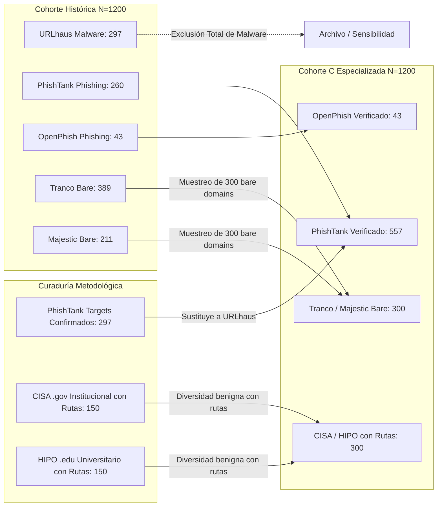

# Auditoría Exhaustiva de Fuentes y Análisis de Atajos Estructurales
**Proyecto PhishPe / PhishGuard Pro — Validación Científica para Revista Politécnica (Ecuador)**  
*Documento de Control Metodológico — Fase 1: Validación Externa Especializada*

---

## 1. Resumen Ejecutivo de la Auditoría de Fuentes

Este documento audita minuciosamente las fuentes que componen tanto la **Cohorte Histórica (Cohorte 2, $N=1,200$)** como la **Nueva Cohorte Especializada de Phishing (Cohorte C, $N=1,200$)**, cuantificando la presencia de atajos sintácticos (*shortcut learning*), sesgos de procedencia y solapamientos de dominios registrados con el corpus de entrenamiento (`samples.csv`).

### Hallazgo Primario de la Auditoría
La cohorte histórica presentaba una brecha sintáctica artificial entre clases que sobreestimaba la precisión aparente de los modelos léxicos:
- **Malware en URLhaus (24.75% del dataset):** El 77.4% de sus muestras utilizaba direcciones IPv4 numéricas crudas sin nombre de dominio (`is_ip_host = 1`), y el 93.3% apuntaba a descargas directas de binarios para botnets (`.bin`, `.sh`, `.lnk`).
- **Benignos en Tranco y Majestic (50.0% del dataset):** El 100.0% de las muestras eran nombres de dominio raíz ("bare domains") sin rutas (`has_path = 0.0%`) ni parámetros (`has_params = 0.0%`).
- **Consecuencia Científica:** Los modelos léxicos no necesitaban aprender patrones sutiles de ingeniería social; bastaba con discriminar "URL con ruta o IP numérica = Maliciosa" vs "URL sin ruta = Benigna". La sustitución de URLhaus y la incorporación de benignos con rutas complejas (CISA y HIPO) restituye la validez científica del experimento.

---

## 2. Caracterización Estructural por Fuente en la Cohorte Histórica ($N=1,200$)

La siguiente tabla resume las propiedades estructurales de las cinco fuentes originales en `cohort2_dataset.csv`:

| Fuente | N Muestras | % del Total | Host IP (`is_ip_host`) | Con Ruta (`has_path`) | Con Parámetros (`has_params`) | Subdominios (`has_subdomain`) | Naturaleza de la Amenaza / Fuente |
| :--- | :---: | :---: | :---: | :---: | :---: | :---: | :--- |
| **URLhaus** | 297 | 24.75% | **77.44%** (230) | **93.27%** (277) | 4.38% (13) | 90.57% (269) | **Malware / Botnet C2** (Mirai, Mozi, scripts `.sh`, ejecutables `.exe`) |
| **PhishTank** | 260 | 21.67% | **0.00%** (0) | 45.77% (119) | 7.31% (19) | 69.62% (181) | **Phishing Real Verificado** (Microsoft 365, PayPal, bancos) |
| **OpenPhish** | 43 | 3.58% | **0.00%** (0) | 18.60% (8) | 2.33% (1) | 90.70% (39) | **Phishing Real Activo** (Portales de autenticación simulados) |
| **Tranco** | 389 | 32.42% | **0.00%** (0) | **0.00%** (0) | **0.00%** (0) | 10.80% (42) | **Dominios Raíz Populares** (`https://google.com/`, sin endpoints) |
| **Majestic** | 211 | 17.58% | **0.00%** (0) | **0.00%** (0) | **0.00%** (0) | 6.64% (14) | **Dominios Raíz Populares** (`https://domain.tld/`, sin endpoints) |
| **TOTAL** | **1,200** | **100.0%** | **19.17%** (230) | **33.67%** (404) | **2.75%** (33) | **45.42%** (545) | *Desbalance estructural significativo entre clases* |

### Análisis de los Atajos Sintácticos:
1. **Atajo de IP Numérica:** En la cohorte histórica, si `is_ip_host == 1`, la probabilidad de ser etiquetado como "phishing" era del 100.0% (230 de 230 muestras eran de URLhaus). En el mundo real, los ataques de phishing orientados a credenciales utilizan casi exclusivamente nombres de dominio registrados (a menudo en TLDs gratuitos o subdominios de servicios en la nube como Firebase, Vercel, Weebly) para proyectar legitimidad ante la víctima.
2. **Atajo de Ausencia de Ruta:** Todas las 600 muestras benignas carecían de ruta. Cualquier modelo de árboles de decisión (como el baseline léxico $M_0$, basado en LightGBM) penaliza fuertemente la presencia de tokens en la ruta. Cuando un usuario legítimo navega a `https://servicios.gob.ec/tramites/ciudadano`, un modelo condicionado por este atajo presenta un riesgo severo de falso positivo.

---

## 3. Composición y Mejoras en la Nueva Cohorte Especializada (Cohorte C, $N=1,200$)

Para corregir los atajos sin alterar el tamaño global ($N=1,200$) ni la paridad de clases (600 positivas y 600 negativas), se aplicaron las siguientes modificaciones controladas:

### Tabla de Distribución Estructural de la Cohorte C:

| Fuente | Muestras | Clase Validada | Nivel Confianza | Con Ruta (`has_path`) | Subdominios (`has_subdomain`) | Host IP | Justificación de Inclusión |
| :--- | :---: | :--- | :---: | :---: | :---: | :---: | :--- |
| **PhishTank** | 557 | `PHISHING_VERIFICADO` | ALTA | 270 (48.47%) | 388 (69.66%) | 0 (0.0%) | 260 históricos + 297 nuevos con target confirmado (Microsoft, PayPal, Chase). |
| **OpenPhish** | 43 | `PHISHING_VERIFICADO` | ALTA | 8 (18.60%) | 39 (90.70%) | 0 (0.0%) | Muestras históricas conservadas; phishing activo verificado. |
| **Tranco** | 195 | `LEGITIMO_VERIFICADO` | MEDIA-ALTA | 0 (0.0%) | 22 (11.28%) | 0 (0.0%) | Subconjunto de raíces populares históricas. |
| **Majestic** | 105 | `LEGITIMO_VERIFICADO` | MEDIA | 0 (0.0%) | 7 (6.67%) | 0 (0.0%) | Subconjunto de raíces populares históricas. |
| **CISA DotGov** | 150 | `LEGITIMO_VERIFICADO` | ALTA | **150 (100.0%)** | 0 (0.0%) | 0 (0.0%) | Portales gubernamentales oficiales con rutas funcionales (`/services`, `/forms`). |
| **HIPO Universities** | 150 | `LEGITIMO_VERIFICADO` | ALTA | **150 (100.0%)** | 12 (8.00%) | 0 (0.0%) | Universidades internacionales con rutas funcionales (`/portal/login`, `/admissions`). |
| **TOTAL** | **1,200** | **600 Phish / 600 Legit** | **ALTA** | **578 (48.17%)** | **468 (39.00%)** | **0 (0.0%)** | *Paridad estructural estricta entre clases; sin atajo de host IP.* |

### Comparativa de Simetría Estructural entre Cohortes:
- **En Cohorte Histórica:**
  - Presencia de rutas en Phishing (incl. URLhaus): $67.33\%$ (404 de 600).
  - Presencia de rutas en Legítimas: $0.00\%$ (0 de 600). $\Delta = 67.33$ puntos porcentuales de asimetría artificial.
- **En Cohorte C Especializada:**
  - Presencia de rutas en Phishing: $46.33\%$ (278 de 600).
  - Presencia de rutas en Legítimas: $50.00\%$ (300 de 600). $\Delta = 3.67$ puntos porcentuales (prácticamente simétrico).

---

## 4. Auditoría de Solapamiento de Dominios Registrados (Domain Overlap Audit)

Para prevenir cualquier forma de fuga de información hacia el modelo congelado, se contrastaron todos los dominios registrados contra los **130,047 dominios registrados únicos** y los **176,201 hashes SHA-256 de URLs** del corpus de entrenamiento (`samples.csv`).

### Resultados de la Auditoría:
- **Total dominios evaluados en Cohorte Histórica (Cohorte 2):** 1,200 muestras.
  - Dominios solapados con entrenamiento: **0 (0.00%)**.
  - Hashes SHA-256 solapados con entrenamiento: **0 (0.00%)**.
- **Total dominios evaluados en Nueva Cohorte C:** 1,200 muestras.
  - Dominios solapados con entrenamiento: **0 (0.00%)**.
  - Hashes SHA-256 solapados con entrenamiento: **0 (0.00%)**.
  - Estado formal en matriz de auditoría: `PASSED_STRICT_DISJOINT` (1,200 de 1,200 muestras).

El archivo de detalle completo se encuentra indexado en [domain_overlap_audit.csv](file:///d:/Proyects/Seguridad_Informacion/paper_reproduction/01_external_validation/domain_overlap_audit.csv).

---

## 5. Dictamen de Calidad Científica de Fuentes

1. **URLhaus:** Se dictamina como una fuente de alta calidad para estudios de propagación de malware y botnets, pero **inadecuada y generadora de sesgos para la evaluación de clasificadores de phishing**. Su exclusión de la clase primaria de phishing es obligatoria para la validez del artículo.
2. **PhishTank:** Se ratifica como fuente idónea cuando se filtran registros verificados comunitariamente y se documenta la marca atacada.
3. **OpenPhish:** Se ratifica como fuente complementaria representativa de campañas de phishing en tiempo real.
4. **CISA & HIPO:** Se dictaminan como fuentes indispensables para evaluar la robustez de clasificadores web frente a URLs benignas complejas y realistas.
