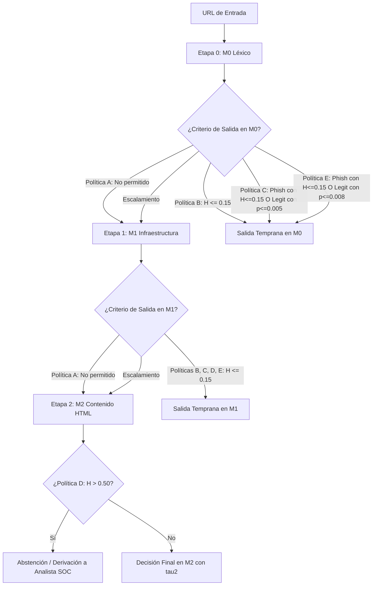

# Metodología Experimental: Cascada Adaptativa, Salida Temprana y Abstención
**Proyecto PhishPe / PhishGuard Pro — Publicación Revista Politécnica (Ecuador)**  
*Documento de Protocolo Científico — Fase 2: Evaluación Rigurosa de Salida Temprana*

---

## 1. Motivación y Objetivos Científicos

En sistemas de detección de phishing basados en arquitecturas multi-etapa o multimodales ($M_0$ Léxico, $M_1$ Red/Infraestructura, $M_2$ Contenido DOM/HTML, $M_3$ Visión por Computador), la adquisición de información adicional introduce un compromiso (*trade-off*) inherente entre **fidelidad de detección** y **coste operacional (latencia de red, tiempo de renderizado y consumo de cómputo)**.

### 1.1. Pregunta de Investigación Central
¿Es posible reducir drásticamente el coste de adquisición de modalidades costosas (especialmente la descarga y parseo de HTML en $M_2$ y la captura de pantalla por CDP en $M_3$) mediante políticas de salida temprana sin inducir una degradación estadísticamente significativa en la detección de ataques sutiles de ingeniería social?

### 1.2. Objetivos Específicos
1. **Verificación Forense:** Contrastar las cifras históricas sobre el conjunto de prueba *host_unseen* ($N=691$), donde una cascada simétrica reportó $F_1 = 0.9222$, un ahorro de 524 adquisiciones de HTML y 25 falsos negativos (13 ocurridos antes de $M_2$).
2. **Control Estricto de Fuga de Umbrales:** Calibrar los umbrales de escalamiento ($H_{esc}$), abstención ($H_{abs}$) y márgenes conservadores exclusivamente sobre el conjunto de **Validación ($N=702$)**, evaluando las políticas sobre el conjunto de **Prueba ($N=691$)** sin optimización *a posteriori*.
3. **Formulación y Comparación de 5 Políticas Alternativas:** Evaluar de forma estrictamente pareada el modelo monolítico completo, la cascada simétrica, la cascada conservadora, la clasificación selectiva con abstención y el rescate focalizado.
4. **Validación Estadística Rigurosa:** Emplear la prueba exacta de discordancias de McNemar, remuestreos bootstrap pareados para $\Delta F_1$ con intervalos de confianza del 95%, y contraste formal de no inferioridad bajo un margen predefinido $\delta = -0.015$.

---

## 2. Definición Formal de las Políticas Evaluadas

### 2.1. Política A: Modelo Completo $M_2$ como Referencia (Monolítico)
- **Definición:** Línea base sin optimización de recursos. Cada observación ejecuta incondicionalmente las tres etapas ($M_0 \to M_1 \to M_2$).
- **Regla de Decisión:**
  $$\hat{y}_A = \mathbb{I}(p_2 \ge \tau_2)$$
  con $\tau_2 = 0.394962$ (calibrado originalmente en validación).
- **Consumo de Modalidades:** Exactamente 3.0 modalidades por muestra; 0.0% de adquisiciones de HTML ahorradas.

### 2.2. Política B: Cascada Histórica Basada en Entropía (Simétrica)
- **Definición:** Cascada secuencial que evalúa la incertidumbre mediante la entropía binaria de Shannon:
  $$H(p) = - \left[ p \log_2(p) + (1-p) \log_2(1-p) \right] \in [0, 1]$$
- **Regla de Salida:**
  - En la etapa $k \in \{0, 1\}$ ($M_0$ y $M_1$):
    $$\text{Si } H(p_k) \le H_{esc} \implies \text{Detener y decidir } \hat{y}_B = \mathbb{I}(p_k \ge \tau_k)$$
    $$\text{Si } H(p_k) > H_{esc} \implies \text{Escalar a la etapa } k+1$$
  - En la etapa terminal $M_2$: $\hat{y}_B = \mathbb{I}(p_2 \ge \tau_2)$.
- **Parámetro Calibrado:** $H_{esc} = 0.15$ (cobertura total, sin abstención).

### 2.3. Política C: Cascada Conservadora (Asimétrica para Proteger contra Falsos Negativos)
- **Justificación Científica:** En ciberseguridad, un Falso Negativo (dejar pasar phishing a la bandeja o navegador de la víctima) acarrea costos desproporcionadamente mayores que un Falso Positivo o una consulta de red adicional. La auditoría reveló que $M_0$ detuvo prematuramente 12 ataques con predicción benigna debido a probabilidades artificialmente bajas ($p_0 \in [0.003, 0.020]$).
- **Regla Asimétrica de Salida:**
  - En $M_0$:
    - Se permite salida temprana para **phishing seguro**: si $p_0 \ge \tau_0$ y $H(p_0) \le H_{esc}$.
    - Para predicciones **benignas** ($p_0 < \tau_0$), **se prohíbe la salida temprana** a menos que $p_0 \le p_{min\_legit} = 0.005$ (probabilidad prácticamente nula). Toda muestra con $0.005 < p_0 < \tau_0$ está obligada a consultar al menos $M_1$.
  - En $M_1$: Se aplica la regla de entropía simétrica estándar con $H_{esc} = 0.15$.
  - En $M_2$: Decisión terminal con $\tau_2$.

### 2.4. Política D: Clasificación Selectiva con Abstención Explícita ($M_5$)
- **Definición:** Reconoce que forzar una clasificación binaria ante probabilidades cercanas al umbral de máxima entropía induce errores sistemáticos. Introduce la opción de rechazo o abstención (*selective classification*):
  $$\text{Acción} = \begin{cases} 
  \text{Abstención} (\text{uncertain}), & \text{si } H(p_{\text{final}}) > H_{abs} \\ 
  \mathbb{I}(p_{\text{final}} \ge \tau_{\text{final}}), & \text{si } H(p_{\text{final}}) \le H_{abs} 
  \end{cases}$$
- **Parámetros:** $H_{esc} = 0.15$, $H_{abs} = 0.50$ (equivalente a nivel de confianza $\ge 0.80$).
- **Sub-Políticas Operativas para Muestras Abstenidas:**
  - **Decididos:** Métrica sobre el subconjunto con veredicto emitido ($\text{Coverage} = N_{\text{decidido}} / N$).
  - **Fail-Closed:** Bloqueo preventivo de las abstenciones (tratadas como phishing).
  - **Fail-Open:** Tránsito permitido de las abstenciones (tratadas como benignas).
  - **SOC Review (Human-in-the-Loop):** Escalamiento a analista de seguridad.

### 2.5. Política E: Cascada con Rescate Focalizado (Experimental / Offline)
- **Definición:** Variante optimizada de la política conservadora que busca recuperar los falsos negativos de $M_0$ sin penalizar a las URLs benignas hiper-seguras:
  - Si una muestra en $M_0$ califica para salida benigna ($p_0 < \tau_0$ y $H(p_0) \le 0.15$), pero su probabilidad se ubica en la zona de incertidumbre residual $p_0 \in (0.008, 0.050]$, se ejecuta una verificación focalizada de bajo coste consultando la infraestructura DNS/TLS ($M_1$).
  - Si $M_1$ ratifica la legitimidad con baja entropía ($H(p_1) \le 0.15$), se detiene en $M_1$ (coste = 2 modalidades en lugar de 3). Solo escala a $M_2$ si $M_1$ detecta anomalías.

---

## 3. Protocolo de Partición y Selección de Umbrales (Validation vs Test)

Para asegurar la validez metodológica:
1. **Partición de Validación ($N=702$):** Se utilizó para evaluar el barrido de $H_{esc} \in [0.01, 0.50]$ y calibrar los umbrales de decisión $\tau_k$.
   - Criterio de parada predefinido: maximizar $F_1$ asegurando una reducción de adquisiciones de HTML $\ge 65\%$ y $\text{FPR} \le 0.0100$.
   - El óptimo seleccionado en validación fue $H_{esc} = 0.15$.
2. **Partición de Prueba ($N=691$):** Partición independiente *host_unseen*, congelada previamente en [`predictions.csv`](file:///d:/Proyects/Seguridad_Informacion/artifacts/m4-real/predictions.csv), utilizada exclusivamente para contrastar las políticas sin reajuste de parámetros.

---

## 4. Metodología de Pruebas Estadísticas Pareadas

### 4.1. Prueba Exacta de Discordancias de McNemar
Para comparar la concordancia en clasificación de dos políticas sobre las mismas 691 observaciones:
- Se construye la tabla de contingencia $2 \times 2$:
  - $n_{11}$: Ambas políticas clasifican correctamente.
  - $n_{00}$: Ambas políticas cometen error.
  - $n_{10}$: Política de Referencia acierta, Política Candidata falla.
  - $n_{01}$: Política de Referencia falla, Política Candidata acierta.
- Dado que el número total de discordancias $d = n_{10} + n_{01}$ es pequeño ($d \le 10$), se utiliza la **prueba binomial exacta** bidireccional bajo $H_0: p = 0.5$:
  $$p\text{-valor} = 2 \cdot \sum_{k=0}^{\min(n_{10}, n_{01})} \binom{d}{k} (0.5)^d$$
- **Regla de Rigor:** Un $p\text{-valor} > 0.05$ **no** demuestra equivalencia; solo indica ausencia de evidencia suficiente para rechazar $H_0$.

### 4.2. Contraste de No Inferioridad y Bootstrap Pareado
- Se define un margen de no inferioridad a priori: $\delta = -0.015$ en $F_1$-Score (es decir, la política candidata no degrada $F_1$ en más de 1.5 puntos porcentuales respecto a la referencia).
- Se calculan $B = 1,000$ remuestreos bootstrap pareados para estimar la distribución empírica de $\Delta F_1 = F_1(\text{Candidata}) - F_1(\text{Referencia})$.
- **Criterio de Aceptación:** Se declara `NO_INFERIOR_CONFIRMADO` si y solo si el límite inferior del intervalo de confianza al 95% supera el margen:
  $$\text{Percentil}_{0.025}(\Delta F_1) \ge \delta = -0.015$$

---

## 5. Medición de Coste y Advertencia sobre Latencia Real

En este estudio se distingue rigurosamente entre:
1. **Modalidades Lógicas Evitadas:** Proporción de muestras que no requieren la ejecución de $M_2$ (HTML/DOM) o $M_3$ (Visión).
2. **Latencia Real de Pared (*Wall-Clock Time*):** Medida en milisegundos mediante telemetría real capturada en [`infrastructure-results-real.jsonl`](file:///d:/Proyects/Seguridad_Informacion/artifacts/analysis-results/infrastructure-results-real.jsonl) y benchmarking en navegador.
- **Advertencia:** Evitar una modalidad no equivale linealmente a tiempo de ejecución ahorrado en producción debido a factores concurrentes de red (DNS caching, conexiones TLS pre-establecidas, timeouts asíncronos y concurrencia multi-hilo).
