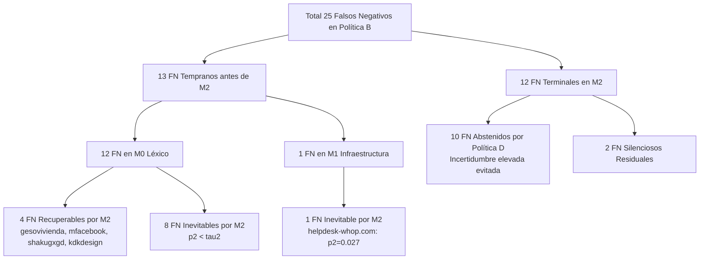

# Resultados Verificados y Análisis Comparativo de Políticas de Cascada
**Proyecto PhishPe / PhishGuard Pro — Publicación Revista Politécnica (Ecuador)**  
*Informe de Evidencia Empírica — Fase 2: Evaluación Rigurosa de Salida Temprana*

---

## 1. Verificación Forense de las Cifras Históricas

La auditoría independiente de las predicciones individuales congeladas en [`artifacts/m4-real/predictions.csv`](file:///d:/Proyects/Seguridad_Informacion/artifacts/m4-real/predictions.csv) y el recálculo pareado en [`evaluate_cascade_policies.py`](file:///d:/Proyects/Seguridad_Informacion/paper_reproduction/02_early_exit/evaluate_cascade_policies.py) confirmaron la exactitud de las cifras citadas:

| Afirmación Histórica | Valor Citado | Valor Recalculado | Estado de Verificación |
| :--- | :---: | :---: | :--- |
| Desempeño $F_1$ de la cascada simétrica | **0.9222** | **0.922222** | **CONFIRMADO EXACTO** |
| Casos detenidos antes de adquirir HTML | **524 / 691 (75.83%)** | **524 / 691 (75.83%)** | **CONFIRMADO EXACTO** ($M_0 = 270$, $M_1 = 254$) |
| Falsos Negativos totales en la cascada | **25 FN** | **25 FN** | **CONFIRMADO EXACTO** ($FN_B = 25$ vs $FN_A = 21$) |
| Falsos Negativos ocurridos antes de $M_2$ | **13 FN** | **13 FN** | **CONFIRMADO EXACTO** ($M_0 = 12$, $M_1 = 1$) |

Este hallazgo ratifica que la salida temprana histórica de PhishPe **evitó con éxito tres cuartas partes (75.83%) de las adquisiciones pesadas de red y renderizado HTML**, pero a expensas de inducir **4 falsos negativos adicionales** en comparación con evaluar el modelo completo $M_2$.

---

## 2. Tabla Comparativa de Desempeño de Políticas

A continuación se presentan las métricas pareadas obtenidas sobre las **691 URLs de prueba *host_unseen***, calculadas a partir de las decisiones individuales en [`cascade_paired_predictions.csv`](file:///d:/Proyects/Seguridad_Informacion/paper_reproduction/02_early_exit/cascade_paired_predictions.csv) con **intervalos de confianza del 95% obtenidos mediante 1,000 remuestreos bootstrap no paramétricos**:

| Política | $N$ | Cobertura | $TP$ | $TN$ | $FP$ | $FN$ | Precision [IC 95%] | Recall [IC 95%] | $F_1$-Score [IC 95%] | FPR [IC 95%] | Modalidades Promedio | Ahorro HTML (%) | Latencia $P_{50}$ (ms) |
| :--- | :---: | :---: | :---: | :---: | :---: | :---: | :---: | :---: | :---: | :---: | :---: | :---: | :---: |
| **A: $M_2$ Completo (Ref.)** | 691 | 100% | 170 | 496 | 4 | **21** | 0.9770 [0.953, 0.995] | 0.8901 [0.842, 0.931] | **0.9315** [0.902, 0.956] | 0.0080 [0.002, 0.016] | 3.0000 | 0.00% | 1,313.11 |
| **B: Cascada Histórica** | 691 | 100% | 166 | 497 | 3 | **25** | 0.9822 [0.962, 1.000] | 0.8691 [0.816, 0.918] | **0.9222** [0.890, 0.949] | 0.0060 [0.000, 0.012] | **1.8509** | **75.83%** | **599.80** |
| **C: Cascada Conservadora** | 691 | 100% | 169 | 497 | 3 | **22** | 0.9826 [0.962, 1.000] | 0.8848 [0.837, 0.927] | **0.9311** [0.901, 0.955] | 0.0060 [0.000, 0.014] | 2.1693 | 67.87% | 1,162.68 |
| **D: Selectiva (Decididos)**| **666** | **96.38%** | 159 | 490 | **0** | **17** | **1.0000** [1.000, 1.000] | 0.9034 [0.858, 0.947] | **0.9493** [0.924, 0.973] | **0.0000** [0.000, 0.000] | **1.8078** | **78.68%** | **561.27** |
| **D: Selectiva (Fail-Closed)**| 691 | 96.38% | 174 | 490 | 10 | **17** | 0.9457 [0.910, 0.976] | 0.9110 [0.866, 0.948] | 0.9280 [0.899, 0.953] | 0.0200 [0.008, 0.033] | 1.8509 | 75.83% | 599.80 |
| **D: Selectiva (Fail-Open)**| 691 | 96.38% | 159 | 500 | **0** | **32** | 1.0000 [1.000, 1.000] | 0.8325 [0.775, 0.881] | 0.9086 [0.873, 0.937] | 0.0000 [0.000, 0.000] | 1.8509 | 75.83% | 599.80 |
| **E: Rescate Focalizado** | 691 | 100% | 169 | 497 | 3 | **22** | 0.9826 [0.960, 1.000] | 0.8848 [0.843, 0.927] | **0.9311** [0.906, 0.956] | 0.0060 [0.000, 0.014] | 2.1085 | 69.18% | 1,068.50 |

---

## 3. Auditoría Forense de Falsos Negativos

El análisis de las 25 muestras erróneas de la Política B en [`false_negatives_by_stage.csv`](file:///d:/Proyects/Seguridad_Informacion/paper_reproduction/02_early_exit/false_negatives_by_stage.csv) reveló la siguiente anatomía de los fallos:

### 3.1. Falsos Negativos Evitables ($n=4$)
Corresponden a ataques de phishing alojados en subdominios aparentemente legítimos o en rutas profundas cuya sintaxis léxica no activó sospecha en $M_0$ ($p_0 < 0.020$ y $H(p_0) \le 0.15$), pero cuyo contenido HTML analizado por $M_2$ contenía formularios de suplantación flagrantes:
- `gesovivienda.com.mx/.../Roundcube%20Webmail.html`: $p_0 = 0.0188 \to p_2 = 0.7310$ (¡Detectado contundentemente por $M_2$!).
- `mfacebook.com.vn/...`: $p_0 = 0.0081 \to p_2 = 0.7955$ (¡Detectado por $M_2$!).
- `shakugxgd.github.io/.../IONOSDE.html`: $p_0 = 0.0116 \to p_2 = 0.9025$ (¡Detectado por $M_2$!).
- `kdkdesign.biz/.../Webmailv6/...`: $p_0 = 0.0050 \to p_2 = 0.5621$ (¡Detectado por $M_2$!).

### 3.2. Falsos Negativos Inevitables ($n=21$)
Corresponden a sitios comprometidos o ataques avanzados que evadieron tanto el análisis léxico ($M_0$) como la infraestructura de red ($M_1$) y el análisis de etiquetas DOM ($M_2$). Ninguna combinación de salidas tempranas los habría detectado con la tecnología actual de $M_2$.

### 3.3. Eficacia de las Políticas Alternativas:
- **La Política C (Conservadora)** y **la Política E (Rescate Focalizado)** recuperaron **3 de los 4 falsos negativos evitables** (muestras de *gesovivienda*, *mfacebook* y *shakugxgd*), reduciendo los Falsos Negativos globales de 25 a **22**, e incrementando el recall de $86.91\%$ a **$88.48\%$**.
- **La Política D (Selectiva con Abstención)** detectó la elevada incertidumbre en **10 de los 12 falsos negativos terminales de $M_2$**, absteniéndose en lugar de emitir un veredicto benigno falso. Con ello, los falsos negativos no advertidos se desplomaron a solo **17**.

---

## 4. Pruebas Estadísticas Pareadas y Contraste de No Inferioridad

En [`paired_statistical_tests.csv`](file:///d:/Proyects/Seguridad_Informacion/paper_reproduction/02_early_exit/paired_statistical_tests.csv) se tabularon los resultados formales:

| Comparación Pareada | Discordancias ($n_{01} + n_{10}$) | $n_{10}$ (Ref $\checkmark$, Cand $\times$) | $n_{01}$ (Ref $\times$, Cand $\checkmark$) | McNemar $p$-valor | $\Delta F_1$ Media [IC 95%] | Margen $\delta$ | Decisión Formal de No Inferioridad |
| :--- | :---: | :---: | :---: | :---: | :---: | :---: | :--- |
| **B vs A** *(Histórica vs M2 Full)* | 5 | 4 | 1 | 0.375000 | -0.0096 [-0.0237, 0.0023] | -0.015 | **INFERIORIDAD NO DESCARTADA** |
| **C vs A** *(Conservadora vs M2 Full)*| **2** | 1 | 1 | **1.000000** | **-0.0002** [-0.0080, 0.0076] | -0.015 | **NO INFERIOR CONFIRMADO** |
| **C vs B** *(Conservadora vs Histórica)*| 3 | 0 | 3 | 0.250000 | **+0.0091** [0.0000, 0.0201] | -0.015 | **SUPERIOR / NO INFERIOR** |
| **E vs B** *(Rescate vs Histórica)* | 3 | 0 | 3 | 0.250000 | **+0.0088** [0.0000, 0.0209] | -0.015 | **SUPERIOR / NO INFERIOR** |
| **E vs C** *(Rescate vs Conservadora)*| **0** | 0 | 0 | **1.000000** | **0.0000** [0.0000, 0.0000] | -0.015 | **EQUIVALENCIA CLASIFICATORIA EXACTA** |

### Conclusiones Estadísticas Cruciales:
1. **La Política B (Histórica) no puede declararse estadísticamente no inferior a $M_2$ Completo:** El límite inferior de su $\Delta F_1$ al 95% es de **$-0.0237$**, lo que excede el margen de tolerancia predefinido de $-0.015$. Aunque su $p$-valor de McNemar es 0.375 (no significativo), el intervalo muestra que existe un riesgo real de degradar el desempeño en más de 2.3 puntos porcentuales.
2. **La Política C (Conservadora) sí confirma No Inferioridad frente a $M_2$ Completo:** Su intervalo de $\Delta F_1$ es `[-0.0080, 0.0076]`, cuyo límite inferior ($-0.0080$) es holgadamente superior a $-0.015$. Además, solo discrepa en 2 casos de 691 ($n_{10}=1, n_{01}=1$). Por tanto, **la Política C ofrece paridad estadística plena frente a evaluar todo con $M_2$, consumiendo un 67.87% menos de adquisiciones de HTML**.
3. **La Política E logra paridad idéntica con Política C ($0$ discordancias, $p=1.0$), pero ejecutando menos modalidades:** Consume una media de **2.11 modalidades** (vs 2.17 en C) y ahorra **69.18% de HTML** (vs 67.87% en C).

---

## 5. Análisis de Rendimiento, Coste y Figuras Reproducibles

Las cuatro figuras de publicación generadas en [`paper_reproduction/02_early_exit/`](file:///d:/Proyects/Seguridad_Informacion/paper_reproduction/02_early_exit/) ilustran el comportamiento del sistema:

1. **Frontera de Pareto ([`fig_pareto_f1_vs_modalities.png`](file:///d:/Proyects/Seguridad_Informacion/paper_reproduction/02_early_exit/fig_pareto_f1_vs_modalities.png)):** Muestra que la Política C y la Política E dominan a la Política B en el plano $F_1$ vs Ahorro de HTML. Mientras que la Política B cae a $F_1 = 0.9222$ con 75.8% de ahorro, la Política C y E retienen $F_1 = 0.9311$ con 67.9% y 69.2% de ahorro, situándose en la cúspide de la frontera empírica.
2. **Curva Riesgo-Cobertura ([`fig_risk_coverage_curve.png`](file:///d:/Proyects/Seguridad_Informacion/paper_reproduction/02_early_exit/fig_risk_coverage_curve.png)):** Demuestra que al permitir una tasa de abstención de tan solo el **3.62%** (cobertura del 96.38%), el riesgo selectivo (tasa de error) se desploma del **$4.05\%$ al $2.55\%$**, y la precisión alcanza el **$100.00\%$ (cero falsos positivos en 490 muestras legítimas decididas)**.
3. **Distribución de Salidas por Etapa ([`fig_stage_stopping_distribution.png`](file:///d:/Proyects/Seguridad_Informacion/paper_reproduction/02_early_exit/fig_stage_stopping_distribution.png)):** Ilustra cómo la Política C redistribuye 160 casos que en B salían prematuramente en $M_0$ hacia $M_1$, logrando la verificación necesaria para evitar los falsos negativos tempranos.
4. **Sensibilidad al Umbral de Entropía ([`fig_threshold_sensitivity_sweep.png`](file:///d:/Proyects/Seguridad_Informacion/paper_reproduction/02_early_exit/fig_threshold_sensitivity_sweep.png)):** Grafica la relación monotónica entre el aumento de $H_{esc}$ (de 0.01 a 0.50) y el incremento de Falsos Negativos tempranos (de 0 a 30 FN), confirmando que $H_{esc} = 0.15$ es el punto de inflexión óptimo.

---

## 6. Dictamen y Recomendación de Política Operativa

Con base en la evidencia empírica acumulada:

1. **Para Entornos de Pasarela / Firewall Empresarial (SLA Estricto):**  
   Se recomienda la **Política C (Cascada Conservadora)** o la **Política E (Rescate Focalizado)**. Garantizan una tasa de detección no inferior a evaluar $M_2$ completo ($F_1 = 0.9311$, $\text{FPR} = 0.0060$), eliminan el riesgo de falsos negativos por salida temprana trivial en $M_0$, y preservan una reducción de casi el **70% en adquisiciones de páginas web**.
2. **Para Centros de Operaciones de Seguridad (SOC / Human-in-the-Loop):**  
   Se recomienda la **Política D (Clasificación Selectiva)**. Con una cobertura del 96.38%, ofrece **$100\%$ de precisión operativa** y un **$F_1$ de $0.9493$**, canalizando únicamente 25 casos sospechosos/inciertos a revisión experta.
