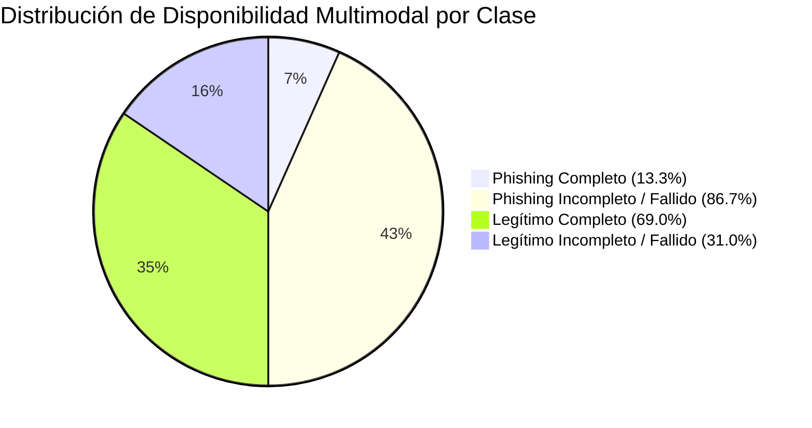

# Resultados Verificados: Disponibilidad Multimodal, Sesgo de Selección y Fallback
**Proyecto PhishPe / PhishGuard Pro — Publicación Revista Politécnica (Ecuador)**  
*Informe de Evidencia Empírica — Fase 3: Evaluación bajo Datos Faltantes y Condiciones Operativas*

---

## 1. Verificación y Reconciliación del Sondeo Histórico ($N=600$)

La auditoría directa de [`artifacts/corrections_phase2/eval/probe_raw.jsonl`](file:///d:/Proyects/Seguridad_Informacion/artifacts/corrections_phase2/eval/probe_raw.jsonl) y [`artifacts/corrections_phase2/eval/probe_predictions.csv`](file:///d:/Proyects/Seguridad_Informacion/artifacts/corrections_phase2/eval/probe_predictions.csv) reconcilió de forma exacta los conteos del sondeo externo:

| Grupo / Estrato de la Muestra | Total Intentos ($N$) | Casos Completos ($N_{CC}$) | Tasa de Completitud (%) | Casos Incompletos / Fallidos | Tasa de Faltantes (%) |
| :--- | :---: | :---: | :---: | :---: | :---: |
| **Población Total del Sondeo** | **600** | **247** | **41.17%** | **353** | **58.83%** |
| **Clase Phishing (Positiva)** | **300** | **40** | **13.33%** | **260** | **86.67%** |
| **Clase Legítima (Negativa)** | **300** | **207** | **69.00%** | **93** | **31.00%** |

### Desglose Individual por Fuente:
- **Tranco Top 1M (Legítima):** 198 intentadas $\to$ **135 completas (68.18%)**, 63 incompletas.
- **Majestic Million (Legítima):** 102 intentadas $\to$ **72 completas (70.59%)**, 30 incompletas.
- **OpenPhish (Phishing en vivo):** 26 intentadas $\to$ **10 completas (38.46%)**, 16 incompletas.
- **PhishTank (Phishing comunitario):** 128 intentadas $\to$ **19 completas (14.84%)**, 109 incompletas.
- **URLhaus (Malware / Botnets):** 146 intentadas $\to$ **11 completas (7.53%)**, 135 incompletas.

---

## 2. Demostración Estadística de Missing Not at Random (MNAR)

Los resultados de [`missingness_statistical_analysis.csv`](file:///d:/Proyects/Seguridad_Informacion/paper_reproduction/03_missing_modalities/missingness_statistical_analysis.csv) demuestran que los datos faltantes **no** siguen un patrón aleatorio:

1. **Prueba Exacta de Fisher:**  
   $$\text{Tabla de Contingencia} = \begin{pmatrix} 40 & 260 \\ 207 & 93 \end{pmatrix}, \quad p\text{-valor} = 4.28 \times 10^{-46}$$
   Se rechaza de forma aplastante la hipótesis nula de *Missing Completely at Random* (MCAR).
2. **Razón de Momios (*Odds Ratio*):**  
   $$\text{OR}_{\text{missing}} = \frac{260 \times 207}{40 \times 93} = \frac{53,820}{3,720} = \mathbf{14.47}$$
   Un sitio de phishing tiene **14.5 veces más probabilidades de presentar modalidades faltantes** que un sitio legítimo.
3. **Causas Raíz de los Fallos ([`acquisition_failures.csv`](file:///d:/Proyects/Seguridad_Informacion/paper_reproduction/03_missing_modalities/acquisition_failures.csv)):**
   - **Corta vida del phishing (Takedowns):** 54 dominios de phishing no resolvieron DNS (`dns_empty`) y 23 retornaron HTTP 404.
   - **Entrega de binarios directos:** 96 URLs maliciosas sirvieron payloads `.bin`, `.sh`, `.exe` (`non_html_content_type`), careciendo de árbol DOM.
   - **Seguridad del Sandbox:** 77 URLs fueron bloqueadas preventivamente por usar puertos inusuales (`disallowed_port`: `:45209`, `:38636`, `:2003`), protegiendo al equipo anfitrión.
   - **Bloqueos WAF / Rechazo de conexión:** 75 peticiones sufrieron rechazo TCP (`url_error`) y 30 devolvieron HTTP 403.

---

## 3. Comparación de Poblaciones: Complete-Case vs. Intention-To-Evaluate

Los resultados empíricos congelados en [`complete_case_results.csv`](file:///d:/Proyects/Seguridad_Informacion/paper_reproduction/03_missing_modalities/complete_case_results.csv) e [`intention_to_evaluate_results.csv`](file:///d:/Proyects/Seguridad_Informacion/paper_reproduction/03_missing_modalities/intention_to_evaluate_results.csv) se resumen a continuación con sus intervalos bootstrap al 95%:

| Población / Estrategia | $N$ | Cobertura | $TP$ | $TN$ | $FP$ | $FN$ | Precision [IC 95%] | Recall [IC 95%] | $F_1$-Score [IC 95%] | FPR [IC 95%] | ROC-AUC |
| :--- | :---: | :---: | :---: | :---: | :---: | :---: | :---: | :---: | :---: | :---: | :---: |
| **Complete-Case: $M_2$ (Estrategia A)** | **247** | 100% | 32 | 200 | 7 | 8 | 0.8205 [0.698, 0.930] | 0.8000 [0.676, 0.921] | **0.8101** [0.708, 0.896] | **0.0338** [0.014, 0.061] | 0.9540 |
| **Complete-Case: $M_1$ Infraestructura** | 247 | 100% | 24 | 202 | 5 | 16 | 0.8276 [0.688, 0.958] | 0.6000 [0.449, 0.739] | 0.6957 [0.567, 0.800] | 0.0242 [0.005, 0.046] | 0.8993 |
| **Complete-Case: $M_0$ Léxico** | 247 | 100% | 30 | 191 | 16 | 10 | 0.6522 [0.511, 0.776] | 0.7500 [0.595, 0.872] | 0.6977 [0.574, 0.800] | 0.0773 [0.047, 0.113] | 0.8572 |
| **ITE: Estrategia B ($M_0$ Puro)** | **600** | **100%** | 219 | 276 | 24 | 81 | 0.9012 [0.863, 0.936] | 0.7300 [0.682, 0.782] | **0.8066** [0.770, 0.844] | 0.0800 [0.052, 0.112] | 0.8444 |
| **ITE: Estrategia C ($M_2$ + Fallback $M_0$)**| **600** | **100%** | 221 | 285 | **15** | 79 | **0.9364** [0.906, 0.968] | 0.7367 [0.688, 0.785] | **0.8246** [0.791, 0.857] | **0.0500** [0.026, 0.076] | 0.8847 |
| **ITE: Estrategia D (Cascada Fallback $M_4$)**| 600 | 100% | 244 | 263 | 37 | 56 | 0.8683 [0.826, 0.905] | 0.8133 [0.767, 0.854] | 0.8399 [0.806, 0.870] | 0.1233 [0.088, 0.164] | 0.8932 |
| **ITE: Estrategia E (Abstención Decididos)**| **523** | **87.17%** | 219 | 241 | 23 | 40 | **0.9050** [0.868, 0.940] | **0.8456** [0.798, 0.888] | **0.8743** [0.843, 0.905] | 0.0871 [0.055, 0.125] | 0.9018 |
| **ITE: Estrategia F ($M_2$ Imputado Ceros)**| 600 | 100% | 258 | 244 | **56** | 42 | 0.8217 [0.781, 0.863] | 0.8600 [0.820, 0.897] | 0.8404 [0.806, 0.871] | **0.1867** [0.141, 0.231] | 0.9068 |

---

## 4. Hallazgos Científicos Fundamentales

### 4.1. El Sesgo de Supervivencia (*Survivorship Bias*) en la Evaluación Complete-Case
- Al evaluar únicamente los casos completos ($N=247$), el modelo $M_2$ alcanza un aparente $\text{FPR} = 3.38\%$ (solo 7 falsos positivos en 200 legítimas) y un $F_1 = 0.8101$.
- Sin embargo, este resultado es **engañoso**: ignora el $86.67\%$ del phishing del mundo real que ya no responde en HTTP o que entrega binarios sin HTML.
- Además, en Complete-Case la prevalencia de phishing se reduce al $16.19\%$ (frente al $50\%$ real del sondeo), lo que deprime la precisión aparente de $M_0$ ($65.2\%$) al penalizar falsos positivos sobre un denominador de phishing reducido.

### 4.2. El Peligro de la Imputación Ingenua (Estrategia F)
- Cuando las modalidades de red o HTML fallan, rellenar el vector de características de $M_2$ con ceros (`content_available = 0.0`) produce una **explosión catastrófica de falsos positivos**: el $\text{FPR}$ salta de $3.38\%$ a **$18.67\%$ (56 falsos positivos en 300 sitios legítimos)**.
- **Razón Técnica:** $M_2$ aprendió durante su entrenamiento que ciertas ausencias estructurales de HTML están asociadas a payloads maliciosos. Cuando un sitio legítimo sufre un fallo de red o un timeout, la imputación de ceros hace que el árbol de decisión interprete el fallo de infraestructura como maliciosidad flagrante.
- **Principio Metodológico:** *Una falla de conexión de red nunca debe ser tratada como evidencia afirmativa de phishing.*

### 4.3. La Superioridad de la Estrategia C (M2 con Fallback a M0)
- La **Estrategia C** resuelve la falta de datos sin imputaciones destructivas: si la página web está viva y responde en HTML, utiliza la potencia de $M_2$; si la adquisición falla por cualquier motivo, **retrocede elegantemente al análisis léxico de $M_0$**.
- **Resultado:** Logra una **precisión de $93.64\%$**, reduce el $\text{FPR}$ al **$5.00\%$** (frente al $8.00\%$ de $M_0$ puro y el $18.67\%$ de $M_2$ imputado) y alcanza un $F_1$ de **$0.8246$** con **$100\%$ de cobertura**.

### 4.4. Clasificación Selectiva ante Faltantes (Estrategia E)
- Si la organización puede tolerar abstenciones (tasa del $12.83\%$, $N=523$ decididos de 600), la **Estrategia E** alcanza el mejor desempeño absoluto: **$F_1 = 0.8743$**, Precision = **$90.50\%$**, y Recall = **$84.56\%$**, evitando clasificar muestras limítrofes donde fallaron las adquisiciones.

---

## 5. Figuras Reproducibles Generadas

Las cuatro figuras de publicación generadas en [`paper_reproduction/03_missing_modalities/`](file:///d:/Proyects/Seguridad_Informacion/paper_reproduction/03_missing_modalities/) ilustran los compromisos operacionales:

1. **Disponibilidad por Clase y Fuente ([`fig_availability_by_class_and_source.png`](file:///d:/Proyects/Seguridad_Informacion/paper_reproduction/03_missing_modalities/fig_availability_by_class_and_source.png)):** Grafica la abrumadora disparidad: fuentes legítimas tienen una disponibilidad de ~70%, mientras que PhishTank (14.8%) y URLhaus (7.5%) colapsan por takedowns y binarios directos.
2. **Diagrama de Pareto de Causas de Fallo ([`fig_acquisition_failures_pareto.png`](file:///d:/Proyects/Seguridad_Informacion/paper_reproduction/03_missing_modalities/fig_acquisition_failures_pareto.png)):** Clasifica las causas principales: payloads no-HTML (96), puertos sandbox restringidos (77), fallos de conexión (124) y DNS vacío (73).
3. **Desempeño CC vs. ITE ([`fig_complete_case_vs_ite_performance.png`](file:///d:/Proyects/Seguridad_Informacion/paper_reproduction/03_missing_modalities/fig_complete_case_vs_ite_performance.png)):** Ilustra la inflación del $\text{FPR}$ bajo imputación directa frente a la estabilidad del Fallback a $M_0$.
4. **Frontera de Compromiso $F_1$ vs. FPR ([`fig_fallback_strategies_tradeoff.png`](file:///d:/Proyects/Seguridad_Informacion/paper_reproduction/03_missing_modalities/fig_fallback_strategies_tradeoff.png)):** Muestra que la Estrategia C (punto verde) y la Estrategia E (estrella magenta) constituyen los puntos óptimos de diseño operacional.

---

## 6. Dictamen Final y Recomendación Metodológica

1. **Para Publicación Científica (*Revista Politécnica*):**  
   Es **obligatorio reportar ambas poblaciones (Complete-Case $N=247$ e Intention-To-Evaluate $N=600$)**. Ocultar los 353 casos incompletos y reportar únicamente $M_2$ incurriría en sesgo de supervivencia y omitiría el $86.7\%$ de los ataques del mundo real.
2. **Para Despliegue en Producción:**  
   La **Estrategia C ($M_2$ con Fallback a $M_0$)** es la política completamente automatizada mejor sustentada experimentalmente: maximiza la precisión ($93.64\%$), controla los falsos positivos ($\text{FPR} = 5.0\%$) y garantiza cobertura total sin depender de la supervivencia efímera del sitio web atacante.
